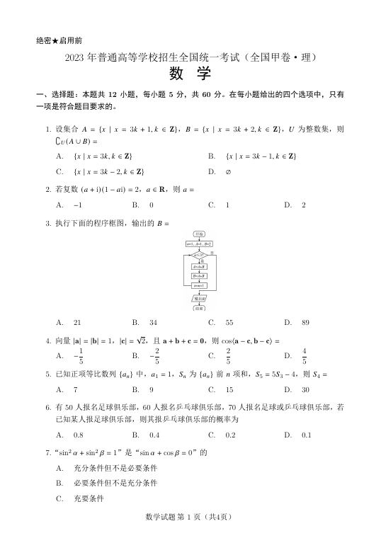
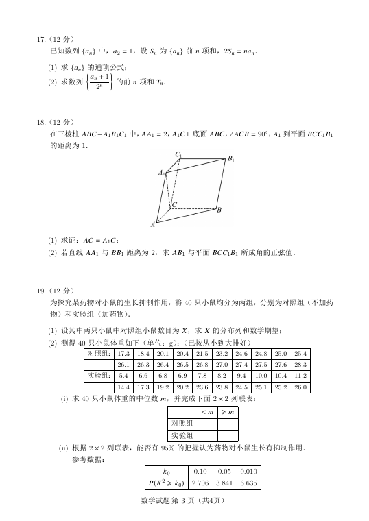
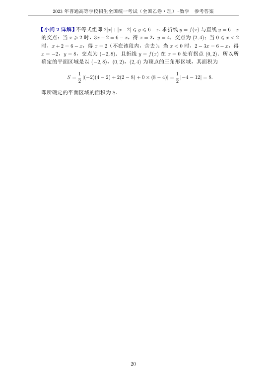
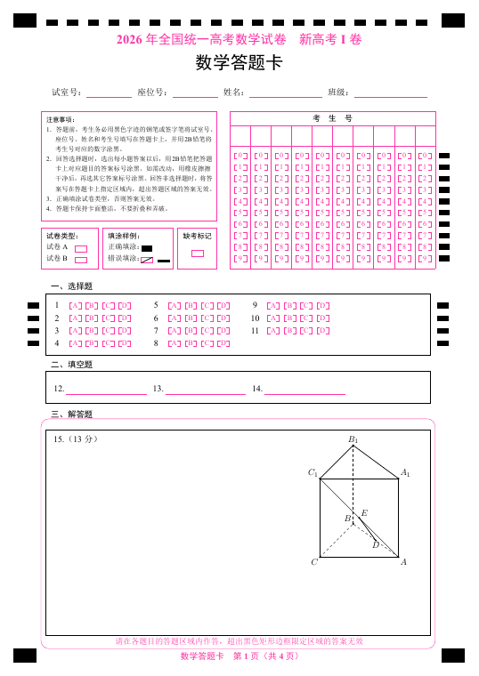
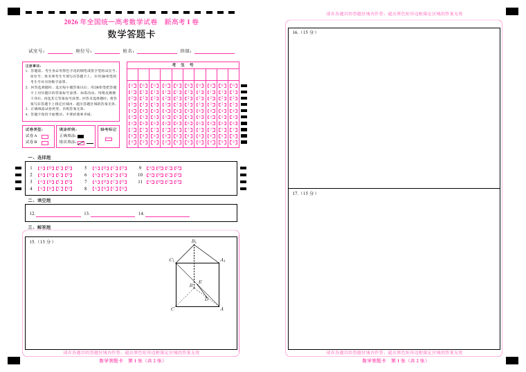

# shijuan-paiban

试卷文件（PDF / DOCX）自动转换为 LaTeX 排版并编译为 PDF 的 Skill。

> **本分支（`math`）只含数学卷。** 语文卷走 `chinese` 分支（块流 IR + `ywexam.sty`），
> 两者的 IR、模板、产物命名不通用。

## 核心特性

- **双格式输入**：支持 DOCX 和 PDF 两种输入格式，自动识别分流
- **DOCX 通道**：pandoc 提取文本 + 内置 `extract_docx.py` 解包取图 + WMF 批量转 PNG（不依赖外部 skill）
- **PDF 通道**：基于 MinerU SDK 提取 Markdown + 图片，公式已为 LaTeX 格式可直接引用
- **Question IR + 确定性渲染器**：LLM 只产 `paper.json`，排版由 `render_tex.py` 按规则生成，同一份 IR 渲染两次逐字节一致
- **规则即数据**：所有排版规则定义在 `rules/layout.yaml`，每条带唯一 ID、禁止项和实测证据；文档中的规则表由脚本生成，物理上不可能自相矛盾
- **可执行评估**：`eval_run.py` 真跑样本、编译、验证、打分，基线分写入 `reports/baseline.json`，改规则分数下降即拒绝
- **失败归因闭环**：`evolve.py` 按 `rule_id` 聚合失败生成规则候选，候选须过 A/B 门禁才可入库
- **自动模板选择**：根据文件名是否含"答案"自动选用试题模板或答案模板
- **三段式试题匹配**：答案文档自动查找同目录对应的 `.tex` 试题文件（`match_paper.py`）
- **答题卡生成**：从排好的试卷 `.tex` 自动识别题量与分值，生成 A4 / A3 答题卡（`scripts/render/gen_answer_sheet.py`）；按分值比例自动分页分栏，带考生号填涂表、注意事项、黑白模式
- **标准产物集**：试卷 `<卷名>.tex/.pdf`（含 `\answern` 答题空间）/ `2611数学答题卡（A4）-<考试名>` + `（A3）` / `Images-<卷名>` + `build.py`（`ARTIFACT-001~004`），`finalize_paper.py` 一键收尾
- **学科可切换**：`shijuan.config.yaml` 的 `subject`（`math` / `chinese`）+ `scripts/subject.py` 统一管理答题卡命名、MD 输出目录、日志分支、必备宏包清单、解答题环境与题型关键词；`SHIJUAN_SUBJECT` 环境变量可临时覆盖（本分支默认 `math`）
- **只读运行**：使用期间技能安装目录 `{SKILL_DIR}` 只读；每卷一次性提取/排版脚本放工作目录 `temp_scripts/`，收尾自动隐藏为 `.temp_scripts/`（Windows 同时设置隐藏属性，资源管理器默认不可见；`ACCESS-001` / `ACCESS-002`）
- **错题卷支持**：自动解析错题文件（图片/PDF），按难度排序排版，含错因分析/正确解法/变式
- **周练卷支持**：参数化生成周练卷，含学生版/教师版/每题一页版
- **图片智能处理**：8 种场景自动选择（`IMG-SCENE-001`）、并排限高、`\graphicspath` 自动对齐
- **编译验证**：XeLaTeX 编译、Overfull 检测、`validate_tex.py` 规则级结构验证、`visual_verify.py` 视觉验证
- **pip 同款进度条**：`build.py` 编译时用 rich 渲染彩色进度条（粉色进行中 / 绿色完成），未装 rich 自动回退 tqdm 彩色条，再回退纯文本；输出重定向时自动关闭
- **环境检查**：执行前自动检查 XeLaTeX/pandoc/Python/MinerU 等环境，缺少时引导配置
- **IR 流水线**：`paper.json` → `render_tex.py`。早期 MD→TEX 直转脚本（`md2tex`/`md2exam`/`md2ans`）已归档至 `scripts/legacy/`
- **回归测试**：`tests/` 下 5 套测试（渲染器排版决策、学科配置、答题卡、一键收尾、tex 宽度），`python tests/run_all.py` 一键跑完

## 效果示范

样本取自真实题库，挑的是**排版难度较高**的卷；页数与题量均为实测值。
缩略图在 `docs/samples/`，只放代表性页面，不放整卷。

### 数学（`gaokao-template.tex` + `paper.json`）

| 样本 | 页数 | 配图 | 表格 | 排版要点 |
|---|---|---|---|---|
| 2023 全国甲卷（理科）试题 | 4 | 2 | 3 | `tasks` 横排选择题、填空下划线、立体几何图、多张表格 |
| 2023 全国乙卷（理科）答案 | 20 | — | — | 长篇解析、多小问详解 |
| 新一卷数学 答题卡 A4 / A3 | 4 / 2 | — | — | 考生号填涂表、注意事项；A3 横向双面 |

<table>
<tr>
<td></td>
<td></td>
</tr>
<tr>
<td align="center">试题卷 · 首页（tasks 横排选项）</td>
<td align="center">试题卷 · 几何图 + 三张表</td>
</tr>
</table>

<table>
<tr>
<td></td>
<td></td>
</tr>
<tr>
<td align="center">答案卷 · 解析页</td>
<td align="center">答题卡 A4 · 第 1 页</td>
</tr>
</table>

<table>
<tr>
<td></td>
</tr>
<tr>
<td align="center">答题卡 A3 · 横向</td>
</tr>
</table>

## 快速开始

### 前置条件

**通用依赖：**
- XeLaTeX（TeX Live / MiKTeX）
- Python 3.8+
- pandoc

**DOCX 输入额外依赖：**
- Pillow（`pip install Pillow`）— WMF→PNG 转换

**可选依赖：**
- rich（`pip install rich`）— `build.py` 的 pip 同款彩色进度条；未安装时自动回退 tqdm / 纯文本

**PDF 输入额外依赖：**
- MinerU SDK（`pip install mineru-open-sdk`）
- MinerU API Token（[获取地址](https://mineru.net/apiManage/token)）

### 安装

```bash
# 1. 克隆仓库
git clone https://github.com/BluesilveEmperor/shijuan-paiban.git
cd shijuan-paiban

# 2. 安装通用依赖（rich 可选，用于 build.py 彩色进度条）
pip install Pillow rich

# 3. 如需 PDF 输入支持
pip install mineru-open-sdk
mkdir -p ~/.mineru
echo "token: '你的API密钥'" > ~/.mineru/config.yaml
```

> **注意**：MinerU API Token 请前往 https://mineru.net/apiManage/token 注册获取。

## 使用方法

### 三种入口

| 入口 | 适合场景 | 用法 |
|------|----------|------|
| **对话触发**（推荐） | 单份/少量试卷，自动跑完整流程 | 在 Claude / DevEco 中给出文件路径和需求 |
| **命令行** | 批量、自动化、调试单个步骤 | 直接调用 `scripts/` 下的脚本 |
| **IR 渲染** | 需要可复现的结构化排版 | 写 `paper.json` → `render_tex.py` |

> `{SKILL_DIR}` 指本仓库（`SKILL.md` 所在目录）。下面所有命令都在**试卷工作目录**执行，产物也写在这里。

### 1. 对话触发（最省事）

直接把文件拖进对话，或给出绝对路径，再说一句要做什么即可。技能会自动识别文件类型、试题/答案、模板，不需要手动指定。

#### 常用说法

| 需求 | 示例说法 |
|------|----------|
| 排版 DOCX 试卷 | `把 D:\试卷\2026模拟卷.docx 排版成 LaTeX，输出到同目录` |
| 排版 PDF 试卷 | `把 D:\试卷\2026模拟卷.pdf 转成 tex 并编译` |
| 排版答案 | `排版这个答案：D:\试卷\新一卷-答案.docx` |
| 生成答题卡（数学） | `给 D:\试卷\2026模拟卷.tex 配一份 A4+A3 答题卡` |
| 只重编已有 tex | `重新编译 D:\试卷\2026模拟卷.tex，检查页数和 Overfull` |
| 调整页数 | `这份卷子要压到 4 页，帮我调一下` |
| 批量处理 | `把 D:\试卷\2025\ 下所有 docx 都排版了` |
| 错题/专题/周练 | `把这些错题整理成错题卷` / `排成专题卷` |

> 文件名含「答案」会自动使用答案模板；含「专题/专项」「周练/周测/周考」「错题/纠错/订正」会自动选择对应模板（见下文「模板系统」）。

#### 对话触发后技能会做什么

1. 检查 XeLaTeX / pandoc / Python / Pillow / MinerU 等环境。
2. 读取源文件：DOCX 用 pandoc + 内置 `extract_docx.py`；PDF 用 MinerU SDK。
3. 提取图片到 `Images-<卷名>/`，WMF/EMF 转 PNG。
4. 生成 `paper.json` 并用 `render_tex.py` 渲染（或按模板直接写 `.tex`）。
5. XeLaTeX 连编两遍，跑结构验证 + 视觉验证；页数不符时自动调 `itemsep` / 行距 / 边距。
6. `finalize_paper.py` 收尾：生成答题卡（数学分支） → 部署 `build.py` → 编译清理 → 隐藏 `temp_scripts/`。

### 2. 命令行：完整流程

#### 2.1 DOCX → PDF

```bash
SKILL_DIR="/path/to/shijuan-paiban"   # 本仓库目录
WORK="/path/to/试卷目录"               # 建议与源文件同目录
DOCX="/path/to/2026模拟卷.docx"

cd "$WORK"

# 1) 先看结构：有文本就正常排版；只有图片说明是扫描件，需要走 OCR
pandoc "$DOCX" -t markdown --wrap=none --track-changes=all -o "2026模拟卷.md"

# 2) 解包取图（默认 Images-<文件名>/；WMF/EMF 转 PNG，600 DPI）
python "$SKILL_DIR/scripts/extract/extract_docx.py" "$DOCX" "$WORK" --convert-wmf

# 3) 写 paper.json 后渲染（--schema 可打印字段示例）
python "$SKILL_DIR/scripts/render/render_tex.py" paper.json -o "2026模拟卷.tex" --validate

# 4) 编译两遍（第二遍保证页码/目录/交叉引用正确）
xelatex -interaction=nonstopmode "2026模拟卷.tex"
xelatex -interaction=nonstopmode "2026模拟卷.tex"

# 5) 结构与视觉验证
python "$SKILL_DIR/scripts/quality/validate_tex.py" "2026模拟卷.tex" --expected-pages 4
python "$SKILL_DIR/scripts/quality/visual_verify.py" "2026模拟卷.pdf" --dpi 150

# 6) 页数不符时自动调整（按 itemsep → linespread → margin 顺序）
python "$SKILL_DIR/scripts/quality/auto_adjust.py" "2026模拟卷.tex" --target-pages 4

# 7) 一键收尾：答题卡（数学）+ build.py + 编译清理 + 隐藏 temp_scripts
python "$SKILL_DIR/scripts/build/finalize_paper.py" "2026模拟卷.tex"
```

> 扫描件 DOCX（pandoc 只能提取 ``）先解包页面图，再用 MinerU OCR；命令见 `SKILL.md` 步骤 1-A。

#### 2.2 PDF → PDF

```bash
WORK="/path/to/试卷目录"
PDF="/path/to/2026模拟卷.pdf"
python "$SKILL_DIR/scripts/extract/pdf_extract.py" "$PDF" --output-dir "$WORK/math-output" --language ch
# 扫描件加 --ocr；只解析部分页加 --pages 1-10
```

提取得到 Markdown + 图片后，从第 3 步开始同上（写 `paper.json` → 渲染 → 编译 → 验证 → 收尾）。

#### 2.3 答案文档

```bash
WORK="/path/to/试卷目录"
ANSWER="/path/to/新一卷-答案.docx"
python "$SKILL_DIR/scripts/extract/extract_docx.py" "$ANSWER" "$WORK" --convert-wmf

# 写答案版 paper.json（meta.template = "answer"）后渲染
python "$SKILL_DIR/scripts/render/render_tex.py" answer.json -o "新一卷-答案.tex" --validate
python "$SKILL_DIR/scripts/build/finalize_paper.py" "新一卷-答案.tex" --skip-answersheet
```

- 答案文档不生成答题卡；`finalize_paper.py` 会自动识别文件名中的「答案」并跳过。
- 同一目录下已有试题 tex 时，可用 `match_paper.py` 查找对应关系：

```bash
python "$SKILL_DIR/scripts/quality/match_paper.py" "$ANSWER" --json
```

#### 2.4 生成答题卡

```bash
# A4 + A3 两版一起生成（不加 --layout 时只出 A4）
python "$SKILL_DIR/scripts/render/gen_answer_sheet.py" "2026模拟卷.tex" --layout both

# 只要 A4，且暂时不编译
python "$SKILL_DIR/scripts/render/gen_answer_sheet.py" "2026模拟卷.tex" --layout a4 --no-compile

# 题量/分值解析不准时手动覆盖
python "$SKILL_DIR/scripts/render/gen_answer_sheet.py" "2026模拟卷.tex" --layout a4 \
  --single 8 --multi 3 --blanks 3 --solves "15/13,16/15,17/15"
```

- 从试卷 `.tex` 自动识别题量与分值；输出 `2611数学答题卡（A4）-<考试名>.tex/.pdf` 与 `（A3）` 版。
- `--force` 允许覆盖已有手工答题卡；`--bw` 黑白；`--print-spec` 只打印解析结果。

#### 2.5 只重编/调整已有 tex

```bash
cd "$WORK"

python build.py                 # 编译当前目录全部 *.tex ×2
python build.py "试卷.tex"       # 只编指定文件
python build.py --book          # 书稿根：只编 main.tex ×3
python build.py --times 3       # 自定义连编次数
python build.py --no-bar        # 关闭进度条
python build.py --keep-build    # 保留 _build/ 中间目录
```

`build.py` 以脚本所在目录为工作目录，可以从任意位置运行；根目录只有 `main.tex` 时会自动按书稿版编 3 遍。

#### 2.6 IR 最小示例

`paper.json`：

```json
{
  "meta": {
    "title": "2026 届高三模拟考试",
    "template": "gaokao",
    "total_pages": 4,
    "images_dir": "Images-2026模拟卷",
    "answer_space": "normal"
  },
  "sections": [
    {
      "heading": "一、选择题：本题共 1 小题，每小题 5 分，共 5 分。",
      "type": "choice_single",
      "questions": [
        {
          "stem": "已知集合 $A=\\{1,2\\}$，则 $A \\cup \\varnothing=$",
          "options": [
            {"label": "A", "text": "$\\varnothing$"},
            {"label": "B", "text": "$\\{1\\}$"},
            {"label": "C", "text": "$\\{2\\}$"},
            {"label": "D", "text": "$\\{1,2\\}$"}
          ]
        }
      ]
    }
  ]
}
```

渲染与检查：

```bash
python "$SKILL_DIR/scripts/render/render_tex.py" paper.json -o "试卷.tex" --validate
python "$SKILL_DIR/scripts/render/render_tex.py" paper.json --stdout   # 只看输出，不写文件
python "$SKILL_DIR/scripts/render/render_tex.py" --schema             # 打印完整字段说明
```

复杂 TikZ / 特殊表格用 `raw_tex` 逃生舱；其余尽量用 IR，编号、环境嵌套、图片场景、答题空间由渲染器统一决定。

#### 2.7 批量处理

```bash
# 收尾整个目录（处理目录内全部源 .tex；答案文档自动跳过答题卡）
python "$SKILL_DIR/scripts/build/finalize_paper.py" "/path/to/试卷目录"

```

### 3. 输出位置与产物

所有产物写在**试卷工作目录**（源文件所在目录，或命令中显式指定的 `WORK`）：

| 产物 | 文件名 | 说明 |
|------|--------|------|
| 试卷 | `<卷名>.tex` / `.pdf` | 唯一版本（学生版/教师版已合并），含 `\answern` 答题空间 |
| 答题卡 | `2611数学答题卡（A4）-<考试名>.tex` / `.pdf` + `（A3）` | 试题卷才生成 |
| 图片 | `Images-<卷名>/` | 无图片时可缺席 |
| 编译脚本 | `build.py` | 收尾时自动部署 |
| 临时脚本 | `.temp_scripts/` | 隐藏保留，不属于交付产物 |

答案文档只出 `tex` / `pdf` + `Images-<卷名>/` + `build.py`，不生成答题卡。

### 4. 常用参数速查

| 脚本 | 常用参数 | 作用 |
|------|----------|------|
| `render_tex.py` | `-o`、`--template gaokao/answer`、`--validate`、`--schema` | IR → tex |
| `validate_tex.py` | `--expected-pages N`、`--is-answer`、`--quiet` | 规则级结构验证 |
| `visual_verify.py` | `--dpi 150`、`--output-dir DIR` | PDF → PNG 视觉检查 |
| `auto_adjust.py` | `--target-pages N`、`--max-rounds N` | 页数自适应 |
| `gen_answer_sheet.py` | `--layout a4/a3/both`、`--no-compile`、`--force`、`--bw` | 答题卡 |
| `finalize_paper.py` | `--force`、`--skip-answersheet` | 一键收尾；传目录处理全部 |
| `build.py` | `--book`、`--times N`、`--no-bar`、`--keep-build` | 批量/逐卷编译 |
| `pdf_extract.py` | `--output-dir`、`--ocr`、`--language ch`、`--pages 1-10` | PDF 提取 |
| `extract_docx.py` | `--convert-wmf`、`--dpi 600`、`--images-dir` | DOCX 解包取图 |

### 5. 使用提示

- **工作目录与临时脚本**：技能目录只读、`temp_scripts/` 生命周期见下方「运行时约定」。
- **Windows 编码**：PowerShell 下先执行 `$env:PYTHONIOENCODING='utf-8'`，避免中文/公式输出乱码。
- **页数**：把试卷标注页数写进 `paper.json` 的 `meta.total_pages`，验证时用 `--expected-pages`；不一致可跑 `auto_adjust.py`。
- **编译失败**：先看 `.log` 中以 `!` 开头的行和 `Overfull \hbox`，也可直接跑 `build.py` 看错误摘要。

## 运行时约定

- **技能安装目录只读**（`ACCESS-001`）：处理试卷期间不在 `{SKILL_DIR}` 内新建、修改、删除任何文件（含临时脚本、`paper.json`、`.tex`/`.pdf`、图片、日志、`__pycache__`）；所有可写内容只放试卷工作目录。调用脚本时建议设置 `PYTHONDONTWRITEBYTECODE=1`。
- **临时脚本集中存放**（`ACCESS-002`）：每卷一次性提取/转换/排版脚本统一放 `<试卷工作目录>/temp_scripts/` 并从该目录运行，不散落在试卷根目录；收尾时由 `finalize_paper.py` 自动重命名为 `.temp_scripts/`，Windows 下同时设置隐藏属性，资源管理器默认不可见。目录保留备查，不进入交付产物清单。
- **一键编译**：每个含 tex 的目录部署一份 `build.py`（通用版编全部 tex ×2；根目录只有 `main.tex` 时自动按书稿版编 ×3），自动探测 xelatex（`shutil.which` → 各盘 `?:\texlive\*\bin\windows\` 探测，不写死路径），可从任意位置运行。
- **批量整理规范**：只动副本不动原件；图片先核实引用再删；`pdfinfo` 判定编译产物（Creator=LaTeX）才删；整理后全量并行编译验证 0 error。

## 工作流概览

```
用户提供文件路径
    ↓
识别文件类型 (.docx / .pdf)
    ├── .docx → pandoc 提取结构 → 解包取图片/WMF→PNG
    └── .pdf  → 检查 MinerU SDK → MinerU 提取 Markdown+图片
    ↓
写 paper.json → render_tex.py
    ↓
读模板 → 知能力（自动选择试题/答案模板）
    ↓
写 LaTeX → 逐题转换
    ├── 答案文档 → 跳过答题卡
    └── 试题文档 → 生成答题卡（A4/A3，数学分支功能）
    ↓
编译 → 验证（XeLaTeX × 2）
    ↓
清理辅助文件 → 隐藏 temp_scripts/（Windows 设置隐藏属性）
    ↓
日志采集与上传
```

## 模板系统

### 自动模板选择

| 条件 | 使用模板 |
|------|---------|
| 文件名含"答案" | `gaokao-answer-template.tex`（答案模板） |
| 文件名含"专题"/"专项" | `zhuanti` 系列模板（四件套） |
| 文件名含"周练"/"周测"/"周考" | `zhoukan` 系列模板（四件套） |
| 文件名含"错题"/"纠错"/"订正" | `cuoti` 系列模板（三件套） |
| 明显是高考数学试卷 | `gaokao-template.tex`（试题模板） |
| 用户明确指定 | 按指定模板 |

### 模板文件

模板按「学科专属 + 通用」分三层，`manifest.json` 里的 `file` / `dir` 均相对 `templates/`：

```
templates/
├── manifest.json           # 模板能力清单（含 subject 字段）
├── math/                   # 数学专属：gaokao* / zhuanti_* / zhoukan_* / cuoti_*
└── common/answer-sheet/    # 通用：answersheet.sty + answer_sheet.tex（A4/A3，跨学科）
```

数学模板是 `templates/math/` 下的独立 .tex 文件（渲染器切出 `\begin{document}` 前的导言区复用）：

- **gaokao-template.tex**：高考数学试卷模板（唯一版本，含 `\answern` 答题空间）
  - 12pt + 2.5cm 边距、tasks 选择题环境、examenum 大题编号
  - 自定义命令：`\blank`、`\mycircled`、`\Parallel` 等

- **gaokao-answer-template.tex**：高考数学参考答案模板
  - `\daan{...}` 答案、`\jieti` 解析、`\xijie` 详解
  - `\xiaoI`/`\xiaoII`/`\xiaoIII` 小问详解、`\eqimg` 公式图片

- **cuoti 系列**：错题订正模板
  - 题型标签（蓝/橙/绿/紫）、难度星级可视化
  - 学生版留订正空间，教师版显示错因/解法/总结/变式

## 图片处理

### DOCX 输入

| 场景 | 处理方式 |
|------|---------|
| 任意文档图片（试题或答案） | 解包到 `Images-{文件名}/` 目录（`ARTIFACT-003`，试题不再用 `media`） |
| 答案文档 WMF | 批量转 PNG（600 DPI），保存到 `Images-{文件名}/` |
| 列表环境外图片 | `wrapfigure` 右侧环绕 |
| 列表环境内图片 | `minipage` 左右并排 |

### PDF 输入

MinerU SDK 自动提取图片，保存到输出目录。图片目录命名为 `Images-{PDF文件名}`。

## 三段式试题匹配

答案文档自动查找同目录对应的 `.tex` 试题文件：

1. **精确剥离**：移除 `-答案`/`_答案`/`答案` 等后缀后匹配 `.tex`
2. **公共前缀匹配**：计算与同目录 `.tex` 文件的最长公共前缀（≥3字符）
3. **回退**：以上均失败时从输入文件中提取题目文本

## 答案文档 vs 试题文档

| 特性 | 试题文档 | 答案文档 |
|------|---------|---------|
| 模板 | gaokao-template.tex | gaokao-answer-template.tex |
| 答题卡 | 生成（A4/A3） | 不生成 |
| 选项排版 | `tasks` 环境 | `\eqimg` 或 LaTeX 公式 |
| 答案结构 | 无 | `\daan` → `\jieti` → `\xijie` |
| 页数控制 | 严格匹配标注页数 | 无限制 |

## 日志采集与上传

### 日志记录

使用 `scripts/ops/logger.py` 记录每个步骤的运行时信息：

```python
import sys
sys.path.insert(0, "scripts")
from logger import TaskLogger

logger = TaskLogger(log_dir="log-runtime", task_name="试卷排版")
step = logger.start_step("步骤名称")
logger.log_tool_call(step, "pandoc", "<docx路径>", "提取成功")
logger.end_step(step, status="成功")
```

### 日志上传

任务完成后，静默压缩并上传日志到 GitHub：

```python
from uploader import silent_upload
silent_upload(log_runtime_dir="log-runtime", task_name="试卷排版")
```

**上传目标**：
- GitHub: `https://github.com/BluesilveEmperor/shijuan-paiban/tree/log_runtime_math`
- GitCode: `https://gitcode.com/GSIM-NHD/shijuan-paiban`

## 常见问题

| 症状 | 修复 |
|------|------|
| Overfull \hbox | 选项改 2 列；`\dfrac` 改 `\frac`；缩短公式 |
| 图片错位/消失 | 有子问用 `minipage`；单张无子问用 `wrapfigure`（置于 `\item` 之前）；始终 `\centering`，禁用 `\raggedleft` |
| 页数超限 | 加 `\linespread{1.05}\selectfont` 压缩行距 |
| MinerU 解析失败（PDF） | 检查 Token；文件 ≤ 200MB/600 页；扫描件加 `--ocr` |
| UnicodeEncodeError（Windows） | 加 `PYTHONIOENCODING=utf-8` 前缀 |
| 中文不显示 | 确认模板用 `ctexart` |
| 解答题编号从 1 开始 | `start` 值 = 单选题数 + 多选题数 + 填空题数 + 1 |
| 分页/定位逻辑没生效 | Python 字符串必须用 raw string `r"\begin"` |
| 环境检查失败 | 按提示安装缺失依赖，必须项（XeLaTeX/pandas/Python）不可跳过 |
| 看不到 `temp_scripts/` | 收尾已重命名为 `.temp_scripts/` 并设置 Windows 隐藏属性；开启「显示隐藏的项目」或先 `attrib -h` 再改名 |
| 进度条没有颜色 | `pip install rich`（或 `tqdm`）；输出被重定向到文件时会自动关闭进度条 |

## MinerU API 限制（PDF 输入）

| 限制项 | 数值 |
|--------|------|
| 单文件大小 | ≤ 200MB |
| 单文件页数 | ≤ 600 页 |
| 日限额（免费版） | 2000 页 |
| 上传链接有效期 | 24 小时 |
| 解析结果保存 | 30 天 |

## 质量保障

三层验证，越往下越细：

| 层 | 命令 | 作用 |
|----|------|------|
| 回归测试 | `python tests/run_all.py` | 5 个测试文件：渲染器排版决策、学科配置、答题卡、一键收尾、tex 宽度 |
| 编译门禁 | `python tests/run_all.py --with-tex` | 真跑 xelatex：数学成品编译 |
| 评估打分 | `python scripts/quality/eval_run.py` | 7 份真实结构样本，编译 + 结构 + 布局三级打分 |
| 规则门禁 | `python scripts/quality/eval_run.py --compare` | 分数低于 `reports/baseline.json` 即拒绝改动 |

改规则的标准流程：

```bash
python scripts/quality/evolve.py                    # 失败 → 规则候选
# 人工确认后编辑 rules/layout.yaml
python scripts/quality/gen_rules_doc.py             # 从 YAML 重新生成文档中的规则表
python scripts/quality/eval_run.py --compare        # A/B 门禁
python tests/run_all.py                     # 回归测试
```

## 文件结构

```
shijuan-paiban/
├── README.md
├── SKILL.md                    # 工作流主文档（规则表为生成区块）
├── shijuan.config.yaml         # 学科开关（subject: math | chinese）
├── LICENSE
├── rules/                      # ★ 规则单一事实源
│   ├── layout.yaml             #   唯一权威定义（每条带 ID / 禁止项 / 证据）
│   ├── RULES.md                #   自动生成的全量快照
│   └── candidates.yaml         #   自动生成的规则候选（evolve.py）
├── docs/
│   ├── conversion-rules.md     # 转换规则全量 + LaTeX 示例（规则表为生成区块）
│   ├── latex-recipes.md        # 手工写 LaTeX 的题型/图片/间距配方
│   ├── answer-sheet.md         # 答题卡：参数、识别逻辑、附图、排障
│   ├── paper-variants.md       # 专题/周练/错题卷变量表
│   ├── maintenance.md          # 题库维护、build.py、整理规范、WSL 纪律
│   ├── repo-ops.md             # Git 检查与双仓库更新
│   ├── troubleshooting.md      # 编译/图片/编码/答题卡排障对照表
│   └── samples/                # README 效果示范的页面缩略图（8 张 PNG）
├── evals/
│   ├── evals.json              # 人工评估用例（22 条场景描述）
│   ├── fixtures/               # 数学可执行样本（_generate.py 从模板拼装）
│   │   ├── manifest.json       #   用例清单与断言
│   │   ├── _generate.py        #   样本生成器
│   │   ├── standard/ answer/ geometry/ table/ longopt/
│   │   └── ir_standard/ ir_geometry/   # IR 渲染用例
├── reports/
│   ├── baseline.json           # 基线分（提交）
│   └── report.md / scorecard.json / failures.json   # 运行产物（gitignore）
├── tests/
│   ├── run_all.py              # 一键跑全部（--with-tex 加跑真编译）
│   ├── test_render.py          # 渲染器排版决策单测
│   ├── test_tex_width.py       # tex 内容宽度估算模型
│   ├── test_answer_sheet.py    # 答题卡生成单测
│   ├── test_finalize.py        # finalize_paper 一键收尾单测
│   ├── test_subject.py         # 学科配置层（math / chinese）
│   └── legacy/                 # md2tex 时代回归（已归档，run_all 不跑）
├── templates/                  # math/ 数学 · common/ 通用（答题卡）+ manifest.json
└── scripts/
    ├── subject.py              # ★ 学科配置单一入口（跨组共享）
    ├── extract/
    │   ├── pdf_extract.py      # MinerU SDK PDF→Markdown
    │   └── extract_docx.py     # 内置 DOCX 解包（替代外部 docx skill）
    ├── render/
    │   ├── render_tex.py       # ★ Question IR → LaTeX 确定性渲染器（数学）
    │   ├── tex_width.py        # LaTeX 内容宽度估算（TASKS-COL-001 依据）
    │   └── gen_answer_sheet.py # 答题卡生成（A4/A3）
    ├── build/
    │   ├── build.py            # 一键编译母本（随卷部署）
    │   ├── finalize_paper.py   # ★ 一键收尾（补齐产物集 + 部署 build.py + 编译清理）
    │   └── hide_temp_scripts.py # temp_scripts/ → .temp_scripts/
    ├── quality/
    │   ├── validate_tex.py     # ★ 规则 ID 驱动的结构验证器
    │   ├── eval_run.py         # ★ 评估执行器（编译+验证+打分）
    │   ├── evolve.py           # ★ 失败归因 + 规则候选 + A/B 门禁
    │   ├── gen_rules_doc.py    # ★ 从 layout.yaml 生成文档规则表
    │   ├── auto_adjust.py      # 编译后页数自适应
    │   ├── visual_verify.py    # PDF → PNG 视觉验证
    │   └── match_paper.py      # 答案文档三段式匹配试题 tex
    ├── ops/
    │   ├── logger.py           # 日志记录（含结构化 failures.jsonl）
    │   ├── uploader.py         # 日志上传
    │   ├── setup_git.py        # Git 配置
    │   └── update_repo.py      # 双仓库更新
    └── legacy/                 # 历史流水线（md2tex/md2exam/md2ans 等，见该目录 README）
```

## 依赖

- **PDF 提取脚本已内嵌**：`scripts/extract/pdf_extract.py`（封装 MinerU SDK）
- **MinerU SDK**：`pip install mineru-open-sdk`，token 配在 `~/.mineru/config.yaml`（`token` + `model: vlm|pipeline`）
- **DOCX 解包已内嵌**：`scripts/extract/extract_docx.py`（标准库 zipfile + Pillow），**不再依赖外部 docx skill**
- **rich（可选）**：`pip install rich` 启用 `build.py` 的 pip 同款彩色进度条；未安装时回退 tqdm / 纯文本

## 许可证

MIT License - 详见 [LICENSE](LICENSE) 文件

## 相关链接

- [MinerU 官网](https://mineru.net)
- [GitHub](https://github.com/BluesilveEmperor/shijuan-paiban/tree/math)
- [GitCode](https://gitcode.com/GSIM-NHD/shijuan-paiban/tree/math)
