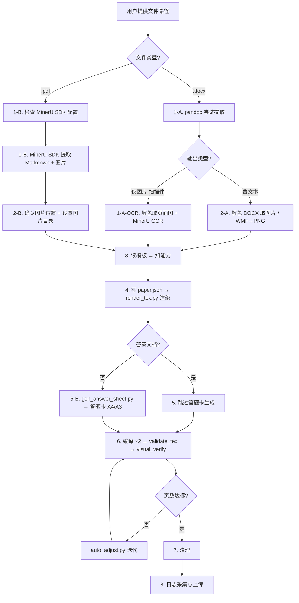

# 试卷 → LaTeX 自动排版

## 工作流概览



## 一句话原则

用户提供 **试卷文件路径**（DOCX 或 PDF）和 **模板路径** → 你全自动完成提取、转换、编译。用户不需要知道任何脚本路径。

需要答题卡时，追加一条命令即可（见「步骤 5-B」），题量与分值自动从排好的试卷 `.tex` 里读。

## ⛔ 硬约束：技能安装目录只读（`ACCESS-001`）

处理试卷期间，`{SKILL_DIR}` **只读**：

- 禁止在 `{SKILL_DIR}` 内新建、修改、删除任何文件——包括临时脚本、`paper.json`、`.tex` / `.pdf`、图片、日志、`__pycache__`、`preview-*.png`。
- 所有可写内容（中间产物、成品、日志）只放**试卷工作目录**（试卷 `.tex` 所在目录）。
- 调用本技能脚本时设置 `PYTHONDONTWRITEBYTECODE=1`（bash）或 `$env:PYTHONDONTWRITEBYTECODE=1`（PowerShell），防止在 `scripts/` 下生成 `__pycache__`。
- 技能维护（改规则、跑仓库回归测试）不属于「使用技能」，可以写 `{SKILL_DIR}`。

收尾自检：`git -C "{SKILL_DIR}" status --short` 应无新增/改动（维护技能时除外）。

## 临时脚本目录：`temp_scripts/`（`ACCESS-002`）

为单份试卷临时生成/改写的提取、转换、排版脚本，按下面规则存放：

1. 统一放**试卷工作目录**下的 `temp_scripts/`，不要散落在试卷根目录，更不要写进 `{SKILL_DIR}`。
2. 从该目录运行：`python temp_scripts/xxx.py ...`；若脚本要 `import` 技能自带模块或调用其子进程，先设 `PYTHONDONTWRITEBYTECODE=1`（或脚本开头 `sys.dont_write_bytecode = True`），避免在 `{SKILL_DIR}/scripts/` 生成 `__pycache__`。
3. 收尾时把整个目录重命名为点前缀 `.temp_scripts/`，Windows 下同时设置隐藏属性（资源管理器默认不可见，需开启「显示隐藏文件」才能看到）：

```bash
python "{SKILL_DIR}/scripts/hide_temp_scripts.py" "<试卷工作目录>"
```

`finalize_paper.py` 收尾时会自动执行这一步。目录保留备查，不进入默认产物清单；再次运行需要临时脚本时，可先把 `.temp_scripts/` 改回 `temp_scripts/`（Windows 需先去掉隐藏属性）。

## 输入格式自动识别

**根据文件扩展名自动选择提取流程：**
- **`.docx` 输入** → 先用 pandoc 尝试提取文本：
  - **含文本内容** → pandoc 方案 + 解包取图片
  - **仅图片（扫描件 DOCX）** → 解包取页面图 + MinerU SDK OCR 识别
- **`.pdf` 输入** → 使用 MinerU SDK 提取 Markdown + 图片

## 关键约定：图片目录命名

**图片目录名自动推导规则**（用户可覆盖，`EXTRACT-001` / `ARTIFACT-003`）：

- **任意输入（DOCX / PDF，试题或答案）**：取文件名去掉扩展名，加前缀 `Images-`
  - 例：`2026新高考模拟.docx` → `Images-2026新高考模拟/`（试题不再用 `media`）

**在后续所有步骤中，用 `{图片目录}` 代表推导出的目录名。**

## 标准产物集（规范化输出）

每份试卷排版完成后，输出目录应形成统一的标准产物集（`ARTIFACT-001` / `ARTIFACT-002`）：

| 产物 | 文件名 | 说明 |
|------|--------|------|
| 试卷 | `<卷名>.tex` / `.pdf` | **唯一版本**（学生版/教师版已合并），含 `\answern` 答题空间 |
| 答题卡 | `2611数学答题卡（A4）-<考试名>.tex` / `.pdf` + `（A3）` | A4 / A3 两种版式 |
| 图片文件夹 | `Images-<卷名>/` | 见上文命名约定 |
| 编译脚本 | `build.py` | 一键编译（通用版母本 `{SKILL_DIR}/scripts/build.py`） |

答案文档（文件名含"答案"）只出三件：`<卷名>.tex/.pdf` + `Images-<卷名>/` + `build.py`。

**一键收尾**（生成/补齐上述产物集 → 部署 build.py → 编译清理 → 打印产物清单）：

```bash
python "{SKILL_DIR}/scripts/finalize_paper.py "<排好的试卷.tex>"
# 可选：--force 重新生成 / --skip-answersheet；传目录则处理目录内全部试卷 .tex
```

## 路径约定

**`{SKILL_DIR}` = 本 SKILL.md 所在目录。**

下文所有脚本引用都写成 `{SKILL_DIR}/scripts/xxx.py`。**不要**用 `find ~/.claude/skills` 之类的全局搜索
定位自己的脚本——那会把技能绑死在特定宿主的目录结构上，换宿主即失效。

DOCX 解包不再依赖外部 `docx` skill，改用内置脚本（只依赖标准库 zipfile）：

```bash
python "{SKILL_DIR}/scripts/extract_docx.py" "<docx路径>" "<输出目录>"
```

## 规则来源

排版规则的唯一权威定义在 **`{SKILL_DIR}/rules/layout.yaml`**（每条规则有唯一 ID、禁止项和证据）。
SKILL.md 与 `docs/conversion-rules.md` 里的规则表由 `scripts/gen_rules_doc.py` 从该文件生成，
**禁止手改生成区块**。改规则 → 改 YAML → `python scripts/gen_rules_doc.py`。

规则变更后必须跑 `python scripts/eval_run.py`，分数不得低于 `reports/baseline.json`。

## 使用前环境检查（必须首先执行）

```bash
# 1. 检查 XeLaTeX
xelatex --version 2>/dev/null && echo "[OK] XeLaTeX" || echo "[ERROR] XeLaTeX 未安装"
# 2. 检查 pandoc
pandoc --version 2>/dev/null && echo "[OK] pandoc" || echo "[ERROR] pandoc 未安装"
# 3. 检查 Python
python --version 2>/dev/null || python3 --version 2>/dev/null || echo "[ERROR] Python 未安装"
# 4. 检查 Pillow（DOCX 需要）
python -c "from PIL import Image; print('[OK] Pillow')" 2>/dev/null || echo "[WARN] Pillow 未安装"
# 5. 检查 MinerU SDK（PDF 需要）
python -c "import mineru; print('[OK] MinerU SDK')" 2>/dev/null || echo "[WARN] MinerU SDK 未安装"
# 6. 检查 MinerU 配置（PDF 需要）
[ -f ~/.mineru/config.yaml ] && echo "[OK] MinerU 配置" || echo "[WARN] MinerU 配置不存在"
# 7. 检查 Git
git --version 2>/dev/null && echo "[OK] Git" || echo "[WARN] Git 未安装"
```

**缺少时的处理：**

| 检查项 | 缺少时的处理 |
|--------|-------------|
| XeLaTeX | **必须安装**：提示用户安装 TeX Live 或 MiKTeX |
| pandoc | **必须安装**：提示用户安装 pandoc |
| Python | **必须安装**：提示用户安装 Python 3.8+ |
| Pillow | **DOCX输入需要**：运行 `pip install Pillow` |
| MinerU SDK | **PDF输入需要**；**扫描件DOCX也需要**：运行 `pip install mineru-open-sdk` |
| MinerU 配置 | **PDF输入需要**；**扫描件DOCX也需要**：引导用户配置 Token（见下方） |

### MinerU SDK 配置引导（PDF输入必须）

> "使用 MinerU SDK 解析 PDF 需要配置 API Token。
> 1. 确保已安装：`pip install mineru-open-sdk`
> 2. 创建配置：`mkdir -p ~/.mineru`
> 3. 编辑 `~/.mineru/config.yaml`，写入：`token: '你的API密钥'`
> 4. 获取密钥：https://mineru.net/apiManage/token
> 配置完成后重新运行即可。"

**⚠️ 只有所有必须项（XeLaTeX、pandoc、Python）都通过后，才能继续执行后续步骤。**

---

## 标准工作流（按顺序执行）

### 步骤 1：读取文件 → 看结构

#### 1-A. DOCX 输入

**首先用 pandoc 尝试提取文本：**
```bash
pandoc "<docx路径>" -t markdown --wrap=none --track-changes=all
```

**判断输出类型：**
- **输出包含文本内容**（标题、题目文本等）→ 按原有 pandoc 方案继续（步骤 2-A 取图片，步骤 4 转换）
- **输出仅包含图片**（扫描件 DOCX，pandoc 只能提取 ``）→ **走 MinerU OCR 方案**：

```bash
# 1. 解包 DOCX 提取页面图片
TEST_DIR="<输出目录>"
mkdir -p "$TEST_DIR/media"
python3 << 'PYEOF'
import zipfile, os
docx_path = "<docx路径>"
out_dir = "$TEST_DIR/media"
with zipfile.ZipFile(docx_path, 'r') as z:
    for f in z.namelist():
        if f.startswith('word/media/') and not f.endswith('/'):
            basename = os.path.basename(f)
            z.extract(f, os.path.join(out_dir, "tmp_media"))
            os.rename(os.path.join(out_dir, "tmp_media", f), os.path.join(out_dir, basename))
import shutil
shutil.rmtree(os.path.join(out_dir, "tmp_media"), ignore_errors=True)
print(f"提取 {len(os.listdir(out_dir))} 张页面图片")
PYEOF

# 2. 对每张页面图片执行 MinerU OCR
MATH_EXTRACT="{SKILL_DIR}/scripts/math_pdf_extract.py"
for img in "$TEST_DIR/media"/image*.png; do
    PYTHONIOENCODING=utf-8 python "$MATH_EXTRACT" "$img" --output-dir "$TEST_DIR/mineru-out" --language ch
done
```

**⚠️ 扫描件 DOCX 的 MinerU 输出处理：**
- 每张页面图片会生成一个独立的 `.md` 文件（如 `image1.md`, `image2.md`...）
- 按顺序合并所有 `.md` 文件的内容，即为完整试卷文本
- 公式已为 LaTeX 格式，可直接嵌入
- 图片引用路径需对应到 `$TEST_DIR/media/` 目录
- **跳过步骤 2-A**（图片已在 OCR 过程中提取），直接进入步骤 3

#### 1-B. PDF 输入（MinerU SDK 方案）

先检查 MinerU 配置：
```python
from pathlib import Path
cfg = Path.home() / ".mineru" / "config.yaml"
if cfg.exists():
    import yaml
    token = yaml.safe_load(cfg.read_text(encoding="utf-8")).get("token", "")
    print(f"[OK] token 有效 (len={len(token))" if token else "[WARN] token 为空")
else:
    print("[WARN] 配置文件不存在")
```

配置好后执行提取：
```bash
MATH_EXTRACT="{SKILL_DIR}/scripts/math_pdf_extract.py"
PYTHONIOENCODING=utf-8 python "$MATH_EXTRACT" "<pdf路径>" --output-dir "<试卷工作目录>/math-output" --language ch
```

**脚本参数：**
| 参数 | 默认值 | 说明 |
|------|--------|------|
| `--output-dir` | `./math-output` | 输出目录 |
| `--model` | `vlm` | pipeline / vlm / html |
| `--ocr` | 关闭 | 扫描件启用 OCR |
| `--language` | `en` | 中文用 `ch` |
| `--pages` | 全部 | 如 `"1-10,15"` |

**MinerU 限制：** 单文件 ≤ 200MB / 600 页；免费版日限额 2000 页

### 步骤 2：提取图片

#### 2-A. DOCX 输入（解包取图片）

**任意文档（试题或答案，目录名默认 `Images-<文件名去扩展名>`，`ARTIFACT-003`）：**
```bash
# 推导图片目录名：Images-<文件名去扩展名>（省略 --images-dir 即用该默认值）
img_dir="Images-$(basename "<docx路径>" .docx)"

# 解包：PNG 直接复制，WMF 自动批量转 600 DPI PNG
python "{SKILL_DIR}/scripts/extract_docx.py" "<docx路径>" "<docx所在目录>" --images-dir "$img_dir" --convert-wmf
```

`extract_docx.py` 只用标准库 zipfile + Pillow，不依赖外部 `docx` skill。
`--convert-wmf` 会把 `word/media/*.wmf` 用 Pillow 渲染为 600 DPI PNG 并删除原 WMF（见 `EXTRACT-003`）。

#### 2-B. PDF 输入（MinerU SDK 自动提取图片）

MinerU 已完成提取，只需确认位置：
```bash
ls ./math-output/  # 确认 .md 和图片文件存在
# 设置 {图片目录} 变量
```

### 步骤 3：读模板 → 知能力

**模板文件位置：** `templates/` 目录（与本 SKILL.md 同级）

**自动模板选择规则：**
| 条件 | 模板文件 |
|------|---------|
| 文件名含"答案" | `templates/gaokao-answer-template.tex` |
| 文件名含"专题"/"专项" | `templates/zhuanti_*.tex` 系列 |
| 文件名含"周练"/"周测"/"周考" | `templates/zhoukan_*.tex` 系列 |
| 文件名含"错题"/"纠错"/"订正" | `templates/cuoti_*.tex` 系列 |
| 默认（高考数学试卷） | `templates/gaokao-template.tex` |

**读取模板后，重点关注：**
- 选择题环境（`tasks`? `choice`?）
- 大题编号（`examenum`? 普通 `enumerate`?）
- 是否已加载 `graphicx`、`wrapfig`
- 自定义命令（`\blank`? `\mycircled`?）
- 当前是否有 `\linespread` 设置

**模板能力清单（manifest）：** 参见 `templates/manifest.json`

### 步骤 4：生成 LaTeX

有两种方式，**优先用方式 A**：

> 需要写一次性提取/转换/排版脚本时，放试卷工作目录的 `temp_scripts/` 并在其中运行（见「临时脚本目录」）；不要写进 `{SKILL_DIR}`，也不要散落在试卷根目录。

#### 方式 A（推荐）：IR + 确定性渲染器

你只负责「理解」——把题目切分成结构化 JSON；排版由脚本做，因此结果可复现、可验证。

```bash
cd "<试卷工作目录>"

# 1. 写 paper.json（格式见 docs/ir-schema.md，或 --schema 打印示例）
python "{SKILL_DIR}/scripts/render_tex.py" --schema

# 2. 渲染（脚本自动决定编号 / tasks 列数 / 图片场景 / 答题空间 / itemsep）
python "{SKILL_DIR}/scripts/render_tex.py" paper.json -o "试卷.tex"

# 3. 渲染后立即验证
python "{SKILL_DIR}/scripts/render_tex.py" paper.json -o "试卷.tex" --validate
```

无法用 IR 表达的结构（复杂 TikZ、特殊表格）用 `raw_tex` 逃生舱，**不要**为了个别题目放弃整个 IR。

#### 方式 B（兜底）：直接写 LaTeX

保留模板的 **完整导言区**，只替换 `\begin{document}` 到 `\end{document}` 之间的正文。

**⚠️ 详细的转换规则见 `docs/conversion-rules.md`，此处仅列核心约束：**

#### 结构约束（不可违反）
1. **选择题外层必须用 `enumerate`，内层选项才用 `tasks`**（`STRUCT-ENV-001`）
2. **解答题必须用 `examenum` 环境**，`start` = 单选题数 + 多选题数 + 填空题数 + 1（`STRUCT-ENV-002` / `ENUM-START-001`）
3. **填空题空位用 `\blank`**（`STRUCT-BLANK-001`）
4. **单张图片硬上限 `0.35\textwidth`，默认 `0.30\textwidth`**（`IMG-W-001` / `IMG-W-002`）

#### 完整规则表（自动生成，勿手改）

<!-- RULES:BEGIN index -->
<!-- 本区块由 scripts/gen_rules_doc.py 从 rules/layout.yaml 生成，请勿手改 -->

| ID | 规则 | 取值 |
|----|------|------|
| `STRUCT-ENV-001` | 选择题外层容器 | 外层 enumerate + 内层 tasks |
| `STRUCT-ENV-002` | 解答题环境 | examenum |
| `STRUCT-BLANK-001` | 填空题空位 | \blank（模板已定义，下划线 2cm） |
| `STRUCT-GLYPH-001` | 圈号字符 ①-⑩ 字形映射 | 导言区用 newunicodechar 把 ①-⑩ 映射到 \mycircled |
| `STRUCT-DIV-001` | 卷部分分隔线（第 I/II 卷） | 选择题部分开始处（单选+多选+填空之前） → \textbf{第I卷（选择题部分（共 <分值> 分））}<br>解答题部分开始处（四、解答题标题之前） → \textbf{第II卷（非选择题，共 <分值> 分）} |
| `IMG-W-001` | 单张图片宽度硬上限 | 0.35\textwidth |
| `IMG-W-002` | 单张题目配图默认宽度 | 0.30\textwidth |
| `IMG-W-003` | 并排图片宽度与高度 | 2 张并排：minipage 0.42\textwidth，图高 3cm<br>3 张并排：minipage 0.28\textwidth，图高 2.5cm |
| `IMG-W-004` | 选项图片宽度 | 0.12\textwidth |
| `IMG-ALIGN-001` | 图片对齐方式（一般场景） | \centering |
| `IMG-ALIGN-002` | 立体几何大题配图对齐 | 解答题立体几何题单个立体图（TikZ 或图片） → flushright 靠右（图与图注如「（第 16 题图）」均右对齐）<br>解答题立体几何题多张图（如折叠前后图 1/图 2） → center 居中并排（minipage 并排 + 各自图注）<br>选择题/填空题配图 → center 居中（遵循 IMG-ALIGN-001） |
| `IMG-SCENE-001` | 图片场景选择 | 小装饰图（行内） → \includegraphics[height=0.6em]<br>列表内单图（无论有无子问） → minipage 左右并排（0.62 文字 + 0.30 图片）<br>图片作为选项 → tasks(4)，图宽 0.12\textwidth<br>图片与长选项并排 → minipage 左选项右图片<br>多张图片并排 → figure[H] + minipage，必须限高<br>TikZ 图 → \resizebox{0.35\textwidth}{!}{...}<br>图片位于 \\begin{examenum} 之前（列表外） → wrapfigure{r}{0.30\textwidth} 右侧环绕 |
| `TASKS-COL-001` | tasks 列数判定 | 含图片且平均长度 < 80 字符 → 4 列<br>含图片且平均长度 ≥ 80 字符 → 2 列<br>平均可见长度 > 25 字符（含公式或纯文字） → 2 列<br>默认（简短选项，含短公式如 $\{0\}$） → 4 列 |
| `TASKS-COL-002` | 禁止竖排图片选项 | 禁止图片选项使用 tasks(1) |
| `TASKS-COL-003` | 宽度兜底——放不下就退列 | 意图列数的单列宽度放不下最长选项 → 退到 2 列<br>2 列仍放不下 → 退到 1 列（纯文字选项允许） |
| `ENUM-START-001` | 解答题起始编号 | start = 单选题数 + 多选题数 + 填空题数 + 1 |
| `ENUM-RESUME-001` | 答案文档编号衔接 | 第一个 enumerate 不带 start，后续统一用 [resume] |
| `PAGE-001` | 试卷页数 | 严格匹配试卷标注页数 |
| `PAGE-002` | 超页压缩手段（按优先级） | 减小解答题 itemsep；导言区加 \linespread{1.05}\selectfont；最后手段：调整 margin |
| `PAGE-003` | 解答题 itemsep 经验值 | 4 页 3 题：2.0 ~ 2.5cm<br>4 页 4 题：1.8 ~ 2.2cm<br>4 页 5 题：1.5 ~ 2.0cm<br>4 页 6 题：1.2 ~ 1.5cm<br>itemsep < 1.0cm 仍超页：降 linespread 至 0.95 |
| `ANS-001` | 答题空间命令与留白量 | \answern：3em，normal 模式（作业，默认） |
| `ANS-002` | 答题空间插入位置 | 每道解答题 \item 内容结束后；最后一道解答题不插入 |
| `ANS-003` | 答题空间禁止线条 | 仅用 \vspace 留白 |
| `EXTRACT-001` | 图片目录命名 | 任意输入（DOCX / PDF，试题或答案）：Images-<文件名去扩展名>（与 ARTIFACT-003 一致，试题不再用 media） |
| `EXTRACT-002` | 扫描件判定 | pandoc 输出仅含  且无正文 → 走 MinerU OCR |
| `EXTRACT-003` | WMF 转 PNG | Pillow 渲染，600 DPI |
| `ARTIFACT-001` | 试题卷标准产物集 | 试卷：<卷名>.tex / .pdf（含 \answern 答题空间，学生版/教师版合并后的唯一版本）<br>答题卡：2611数学答题卡（A4）-<考试名>.tex / .pdf + 2611数学答题卡（A3）-<考试名>.tex / .pdf<br>图片文件夹：Images-<卷名>/<br>编译脚本：build.py |
| `ARTIFACT-002` | 产物命名后缀表 | 答题卡 A4：2611数学答题卡（A4）-<考试名>（由 gen_answer_sheet.py 的 sheet_stem() 统一推导：源卷名含「数学卷/数学试卷-」前缀时去前缀换「数学答题卡（A4/A3）-」，数字前缀随源卷保留；否则回退旧格式 <卷名>-答题卡-A4）<br>答题卡 A3：2611数学答题卡（A3）-<考试名>（推导规则同上） |
| `ARTIFACT-003` | 图片文件夹统一命名 | Images-<卷名>（试题与答案一致，替代旧约定 media） |
| `ARTIFACT-004` | 收尾与部署 | 每个含 tex 的试卷目录部署通用版 build.py；排版完成后用 scripts/finalize_paper.py 一键补齐产物集、编译并清理 preview-*.png |
| `ACCESS-001` | 技能安装目录只读 | 使用技能处理试卷期间，{SKILL_DIR} 只读：不得在其中新建、修改、删除任何文件 |
| `ACCESS-002` | 临时脚本统一放 temp_scripts 并隐藏 | 每卷的提取/转换/排版临时脚本统一放 <试卷工作目录>/temp_scripts/ 并从该目录运行；收尾时重命名为 .temp_scripts 并设置 Windows 隐藏属性 |

> 完整规则（含禁止项与证据）见 [docs/conversion-rules.md](docs/conversion-rules.md)，机器可读源见 [rules/layout.yaml](rules/layout.yaml)。
<!-- RULES:END index -->

#### 题型结构速查
```latex
% 单选
\begin{enumerate}[itemsep=0.3em]
    \item 题目内容
    \begin{tasks}(4)  % 简短选项4列，长选项2列
        \task A \task B \task C \task D
    \end{tasks}
\end{enumerate}

% 多选
\begin{enumerate}[start=9, itemsep=0.5em]
    \item 题目内容
    \begin{tasks}(2)
        \task A \task B \task C \task D
    \end{tasks}
\end{enumerate}

% 填空
\begin{enumerate}[start=12, itemsep=0.8em]
    \item 题目内容 \blank.
\end{enumerate}

% 解答
\begin{examenum}[start=15, itemsep=2.5cm]
    \item （13分）题目描述．
    \begin{examenum}
        \item 第1问；
        \item 第2问．
    \end{examenum}
\end{examenum}
```

#### 图片排版约束

**核心三条**：
- **一般场景用 `\centering`，禁止 `\raggedleft`**（`IMG-ALIGN-001`，图注必须居中于图片正下方）；**例外**：立体几何解答题单个立体图用 `flushright` 靠右、多图并排仍居中（`IMG-ALIGN-002`；LaTeX 无 `right` 环境）
- 单张硬上限 `0.35\textwidth`，默认 `0.30\textwidth`；选项图 `0.12\textwidth`（`IMG-W-001` / `IMG-W-002` / `IMG-W-004`）
- 多图并排必须限高 `height=Xcm,keepaspectratio`（`IMG-W-003`：2 张 3cm / 3 张 2.5cm）

**8 种场景选择**与**图片+选项布局决策**见规则 `IMG-SCENE-001`，
完整 LaTeX 示例见 `docs/conversion-rules.md` 的「图片场景示例」章节。

#### 答题空间插入规则

命令定义在 `templates/gaokao-template.tex` 导言区：`\answern`(3em)（`ANS-001`），
由 `render_tex.py` 按 `meta.answer_space: normal`（默认）自动插入。

**插入位置**：每道解答题的 `\item` 内容结束后、下一 `\item` 之前：

```latex
\begin{examenum}[start=15, itemsep=1.5em]
    \item （13分）题目描述．
    \begin{examenum}
        \item 第1问；
        \item 第2问．
    \end{examenum}
    \answern  % ← 在此处插入答题空间

    \item （15分）下一题...
\end{examenum}
```

**规则**（`ANS-002` / `ANS-003`）：
- 最后一道解答题后**不插入**答题空间（避免尾部留白过多）
- 答题空间命令前需有空行（`\par` 已包含在命令内）
- 纯留白，**禁止** `\rule`、`tcolorbox`、`\fbox` 等任何带线条的命令

#### itemsep 经验值

见 `PAGE-003`（4 页卷：3 题 2.0~2.5cm，4 题 1.8~2.2cm，5 题 1.5~2.0cm，6 题 1.2~1.5cm）。

**调整顺序**（`PAGE-002`）：先调 itemsep → 仍超页加 `\linespread{1.05}\selectfont` → 最后才动 margin。
编译后可交给 `scripts/auto_adjust.py` 自动迭代到目标页数。

#### tasks 列数判定

规则见 `TASKS-COL-001`。`scripts/render_tex.py` 已实现该判定，走渲染器时无需手算。

**示例**：
```latex
% 简短选项 → tasks(4)
\begin{tasks}(4)
    \task $\dfrac{1}{2}$ \task $\dfrac{\sqrt{2}}{2}$ \task $\dfrac{\sqrt{3}}{2}$ \task $1$
\end{tasks}

% 长选项/含公式 → tasks(2)
\begin{tasks}(2)
    \task 双曲正弦函数是增函数
    \task $\tanh(x+y) = \dfrac{\tanh x + \tanh y}{1 + \tanh x \tanh y}$
\end{tasks}

% 图片选项 → tasks(4)
\begin{tasks}(4)
    \task \includegraphics[width=0.12\textwidth]{a.jpg}
    \task \includegraphics[width=0.12\textwidth]{b.jpg}
    \task \includegraphics[width=0.12\textwidth]{c.jpg}
    \task \includegraphics[width=0.12\textwidth]{d.jpg}
\end{tasks}
```

#### 答案文档特殊处理
- `\graphicspath` 必须对齐 `{图片目录}`
- 答案块结构：题目文本 → `\daan{...}` → `\jieti` → `\xijie`
- 解答题多问：`\xiaoI` / `\xiaoII` / `\xiaoIII`
- 选项为图片时用 `\eqimg[0.15]{imageN.png}`
- **不需要 `itemsep` 间距**

#### 页数控制与间距调整
- 试卷页数必须匹配试卷标注（`PAGE-001`）
- 自动迭代到目标页数：
  ```bash
  python "{SKILL_DIR}/scripts/auto_adjust.py" "<tex文件>" --target-pages 4
  ```


#### 答案文档的同目录试题检测

当处理答案文档时，用**三段式匹配**查找同目录下对应的 `.tex` 试题文件（逻辑实现在
`scripts/match_paper.py`，不要在对话里重写）：

```bash
python "{SKILL_DIR}/scripts/match_paper.py" "<答案文档路径>" --json
# → {"matched": "...tex", "stage": "stage1|stage2|stage3", "note": "..."}
```

| 阶段 | 策略 | 命中条件 |
|------|------|---------|
| stage1 | 精确剥离 `-答案` / `_答案` / `答案` / `-参考答案` 后缀 | 剥离后同名 `.tex` 存在 |
| stage2 | 与同目录 `.tex` 求最长公共前缀 | 前缀 ≥ 3 字符 |
| stage3 | 回退 | 从输入文件重新提取题目文本 |

`matched` 为 `null` 时走 stage3，**不要报错退出**。

### 步骤 5：试卷版本（学生版/教师版已合并）

**注意：答案文档（文件名含"答案"）无版本区分，直接渲染即可。**

学生版与教师版已合并为**唯一试卷版本** `<卷名>.tex`：`render_tex.py` 渲染时默认按
`meta.answer_space: normal` 在每道解答题（最后一题除外）后插入 `\answern`（3em 答题空间），
无需任何后处理脚本；`-学生版` / `-教师版` 后缀废止（`ARTIFACT-001` / `ARTIFACT-002`）。

### 步骤 5-B：生成答题卡（可选）

**触发条件**：用户要求"配答题卡""生成答题卡""做A3答题卡"，或试卷是考试/测试用途需要作答区。
答案文档不生成答题卡。

**一条命令搞定**（自动识别题量 + 自动推算版面 + 自动编译）：

```bash
python scripts/gen_answer_sheet.py "<试卷.tex>"
```

| 参数 | 默认 | 说明 |
|------|------|------|
| `--layout` | `a4` | `a4` / `a3` / `both`（a3 每张纸并排两个 A4 版面，对折成册） |
| `--pages` | 自动 | 强制版面数（a4=页数，a3=张数） |
| `--block` | `2` | 每面最多几道解答题 |
| `--percol` | `4` | 选择题每列题数 |
| `--title` / `--subject` | 自动 | 覆盖卷头文字 |
| `--bw` | 关 | 黑白版（不印彩色框线） |
| `--no-compile` | 关 | 只出 `.tex` 不编译 |
| `--no-figs` | 关 | 不附带解答题的图/三线表，只出纯答题区 |
| `--print-spec` | — | 只打印解析结果，用于核对题量与附图 |
| `--suffix` | `答题卡` | 输出文件名后缀（同名手工版已存在时换个后缀即可） |
| `--force` | 关 | 允许覆盖非本脚本生成的文件（默认拒绝） |
| `--single/--multi/--blanks/--solves` | — | 解析失败时手工兜底 |

**两道安全防护（默认开启）：**

- **拒绝非试卷输入**：文件名含 `答案` / `教师版` / `答题卡` / `解析` / `详解` 时直接报错退出（退出码 4）——答题卡只能从试卷解析。
- **不覆盖手工版**：目标 `.tex` 已存在且开头没有本脚本的生成标记时，跳过并提示（退出码 5），原文件分毫不动。确认要替换加 `--force`，或换个 `--suffix`。

**自动识别的题量来源**（读试卷 `.tex` 正文，不依赖文件名）：

| 项 | 识别方式 |
|----|---------|
| 单选 / 多选 | 扫 `\section*{一、…}`、`\noindent\textbf{二、…}` 等小节标题，按"单选/多选/多项选择/多项符合"分类，再数该小节内**顶层** `\item`（自动跳过嵌套 `examenum`） |
| 填空 | 同上，"填空题"小节 |
| 解答题 | 数顶层 `\item`，并从 `（本题满分 13 分）` / `（本小题满分 13 分）` / `（13分）` / `(13 分)` 中取分值 |
| 卷头 | 收集 `\textbf{…}`（容许一层嵌套，如 `\textbf{\LARGE{…}}`）与 `\subtitle{}` / `\subjecttitle{}` / `\title{}`，剔除「绝密★启用前」「试卷类型」「本试卷共…」「一、选择题…」等干扰项，再按「含考试/高考/联考/期末…」加权取最高分；`\\` 换行转全角空格（普通空格会被 ctex 吞掉） |

**版面数自动推算**（复刻 `answersheet.sty` 的分页算法，取最小可行值）：

1. 先找"可行"的最小版面数：**不能有空版面**（多出来的版面会变成一整片空白答题框），且每面解答题数 ≤ `block`；
2. 再看每分能摊到多少答题高度：`可用高度 / 总分 ≥ 1.05cm` 才认可，否则在 +1～+3 版面内找一个达标的；
3. 实测：新高考 19 题 → 4 版面（与宏包预设一致）；22/23 题 → 4 版面（比宏包注释的 5 更紧凑，要更宽松就 `--pages 5`）。

#### 解答题附图 / 三线表（默认开启）

立体几何的题图、统计题的表格会自动搬到答题卡对应题目的作答区，学生直接在图上画辅助线、在表里填数——不用另外打印试题。

| 内容 | 判定 | 放置方式 |
|------|------|---------|
| 单个 `tikzpicture` / `\includegraphics` | 角图 | 作答区右上角，容器宽 6cm |
| `center` 块里并排多图、含 `minipage` | 通栏 | 作答区顶部居中，容器宽 15cm |
| `tabular` / `tabularx` / `longtable`（含三线表） | 通栏 | 同上 |

- **提取粒度**：优先整块取 `center` 环境（保留「图(1) 图(2) 并排」「图 + 图注」的原版式），再捡散落的 `tikzpicture` / `\includegraphics` / `tabular`；同题多个图表会合并成一次调用（宏包按题号存储，重复调用会互相覆盖）。
- **依赖自动跟随**：原卷导言区里 `diagbox` / `booktabs` / `multirow` / `makecell` 等图表宏包、以及 `\usetikzlibrary{…}`、`\graphicspath{…}` 会一并带过来（`geometry` / `fancyhdr` / `hyperref` 这类版式宏包**绝不**搬）。所以 `\diagbox` 斜线表头也能正常排。
- **放不下就降密度**：图是硬内容，压过分隔线会盖住下一题。脚本先估图高，超过答题框 85% 就自动改成「每题独占一面」（`block=1`），并打印 `[INFO]`；单面 24.5cm 仍放不下才 `[WARN]` 让用户手工删减。**不在 TeX 里现场缩放**——量高度易错，缩出来的字号也不可控。
- **编译兜底**：带图版编译失败时（原卷图引用了答题卡里没有的宏/图片），自动退回无图版重编并打印错误摘要，保证答题卡本身一定能出。
- **不要图**：`--no-figs`。

**想调整时**（按优先级）：

| 症状 | 做法 |
|------|------|
| 解答题写不开 | `--pages 5`（加版面） |
| 页面太空 / 太多页 | `--pages 3`，或 `--block 3` |
| 选择题挤成一坨 | `--percol 3`（每列 3 题） |
| 黑白印刷 | `--bw` |
| 某题图太大、自动变成每题一面 | 想要紧凑就 `--no-figs`，或先删原卷里多余的图 |
| 解析出的题量不对 | 先 `--print-spec` 核对，再用 `--single/--multi/--blanks/--solves` 覆盖 |

**输出物**（与试卷同目录）：

```
2611数学答题卡（A4）-<考试名>.tex / .pdf    A4，4 个版面（命名规范见 ARTIFACT-002）
2611数学答题卡（A3）-<考试名>.tex / .pdf    A3 横向，2 张纸（--layout a3/both 时）
answersheet.sty                宏包副本，供日后单独重编
```

**⚠️ 答题卡必须 xelatex 连编两次**（模板用 `remember picture` 定位，一次页码与坐标不准）。
脚本已自动连编两次并清理 `.aux/.log`。

**⚠️ 版式参数改动后若位置错乱**：删掉同名 `.aux` 再连编两次。

**模板本体**：`templates/answer-sheet/answersheet.sty`（宏包）+ `answer_sheet.tex`（骨架，含三档卷型预设注释）。
需要换配色改 `--color`（任意 xcolor 颜色名，默认 `GKpink`）。

**宏包侧的附图接口**（手工建卡时用）：

```latex
\begin{document}
\gkFig{16}{\begin{tikzpicture}...\end{tikzpicture}}   % 右上角小图
\gkBlock{19}{\begin{tabular}{...}...\end{tabular}}   % 顶部通栏（宽表）
\gkMake
\end{document}
```

参数是**题号**（不是第几道）；宏包用 `\long` 定义，内容里可以有空行。

### 步骤 6：编译 → 验证

**试题文档（唯一版本，编译两次）：**
```bash
cd "<输出目录>"
xelatex -interaction=nonstopmode "文件名.tex"
xelatex -interaction=nonstopmode "文件名.tex"
grep -E "Overfull|^!" "文件名.log" | grep -v "infwarerr"
pdfinfo "文件名.pdf" 2>/dev/null | grep Pages
```

**答案文档（只编译一个版本）：**
```bash
cd "<输出目录>"
xelatex -interaction=nonstopmode "文件名.tex"
xelatex -interaction=nonstopmode "文件名.tex"
pdfinfo "文件名.pdf" 2>/dev/null | grep Pages
```

**验证要点：**
- 试卷/答案版页数应与试卷标注一致（`PAGE-001`）
- 解答题编号正确
- 答案文档的【答案】【解析】【详解】结构显示正确

**① 结构验证（必做）**
```bash
python "{SKILL_DIR}/scripts/validate_tex.py" "文件名.tex" --expected-pages 4
python "{SKILL_DIR}/scripts/validate_tex.py" "文件名-答案.tex" --is-answer
```
输出 JSON 报告，每条问题都带 `rule_id`（如 `IMG-W-001`），可直接定位到
`rules/layout.yaml` 里的规则。有 `error` 时退出码为 1，按 `suggestion` 修正后重新编译。

**② 视觉验证（必做）**
```bash
python "{SKILL_DIR}/scripts/visual_verify.py" "文件名.pdf" --dpi 150
```
用 Read 工具查看生成的 `preview-*.png`，确认：图片位置正确、公式渲染正常、无文字溢出。
有问题则修正后重新编译。

**③ 页数不达标时自动迭代**
```bash
python "{SKILL_DIR}/scripts/auto_adjust.py" "文件名.tex" --target-pages 4
```
按 `PAGE-002` 的优先级依次调整 itemsep → linespread → margin。

### 步骤 7：清理与收尾

**推荐：一键收尾**（自动补齐标准产物集 → 部署 build.py → 编译全部 tex ×2 → 清理中间文件与 `preview-*.png` → 隐藏 `temp_scripts/` → 打印产物清单校验，见「标准产物集」章节）：

```bash
python "{SKILL_DIR}/scripts/finalize_paper.py "<文件名.tex>"
```

**兜底（手动清理）：**
```bash
rm -rf "<临时目录>"
rm -f *.aux *.log *.out *.toc *.synctex.gz   # 所有版本
python "{SKILL_DIR}/scripts/hide_temp_scripts.py" "<试卷工作目录>"
```

**保留（即标准产物集，`ARTIFACT-001`）：**
- 试题文档：试卷 `<卷名>.tex/.pdf`（唯一版本，含答题空间）、图片
- 答案文档：`.tex` 源文件、`.pdf`、`{图片目录}/`
- 答题卡：`2611数学答题卡（A4）-<考试名>.tex/.pdf` 与 `（A3）` 版、`answersheet.sty`
- 每卷目录：`build.py`

> `temp_scripts/` 不是交付产物：收尾后应是隐藏的 `.temp_scripts/`；试卷根目录不应出现散落的临时 `*.py`。

### 步骤 8：日志采集与上传

**在试卷工作目录执行**（`log-runtime/` 属于可写产物，禁止写进 `{SKILL_DIR}`）：

```python
import sys
sys.dont_write_bytecode = True  # ACCESS-001：不在 skill 目录生成 __pycache__
sys.path.insert(0, "<skill目录>/scripts")
from logger import TaskLogger
from uploader import silent_upload

logger = TaskLogger(log_dir="log-runtime", task_name="试卷排版")
step = logger.start_step("步骤名称")
# ... 执行步骤 ...
logger.end_step(step, status="成功")

# 上传
silent_upload(log_runtime_dir="log-runtime", task_name="试卷排版")
```

---

## 专题卷 & 周练卷 & 错题卷

### 模板选择规则

| 文件名特征 | 模板系列 | 版本 |
|-----------|---------|------|
| 含"专题"/"专项" | `zhuanti_*.tex` | 四件套（student/teacher/onepage/content） |
| 含"周练"/"周测"/"周考" | `zhoukan_*.tex` | 四件套 |
| 含"错题"/"纠错"/"订正" | `cuoti_*.tex` | 三件套（student/teacher/content） |

### 专题卷变量表

| 变量 | 说明 | 默认值 |
|------|------|--------|
| `zhuantiName` | 专题名称 | 必填 |
| `zhuantiGrade` | 年级 | 必填 |
| `zhuantiDate` | 日期 | 必填 |
| `tierNames` | 分层名称 | 基础巩固,能力提高,拔高挑战 |
| `saqItemSep` | 解答题间距 | 2.5cm |

### 周练卷变量表

| 变量 | 说明 | 备注 |
|------|------|------|
| `zhoukanMode` | 模式 | limited（限时30-45min）/ homework |
| `mcqCount` | 单选题数量 | **必须指定** |
| `msqCount` | 多选题数量 | **必须指定** |
| `blankCount` | 填空题数量 | **必须指定** |
| `saqCount` | 解答题数量 | **必须指定** |

### 错题卷变量表

| 变量 | 说明 |
|------|------|
| `cuotiTitle` | 标题 |
| `cuotiSource` | 错题来源 |
| `cuotiDate` | 日期 |

**错题卷结构（每道错题）：** 题目 → 错误解法（灰色）→ 错因分析（红，教师版可见）→ 正确解法（绿，教师版可见）→ 方法总结（棕，教师版可见）→ 同类变式（青，教师版可见）

---

## 题库维护与批量整理

> **路径配置**：题库根目录不写死在代码里。优先读环境变量 `SHIJUAN_LIBRARY`，
> 未设置时默认 `D:\Music\试题加题库`（本机历史位置）。换机器时只改环境变量，不改文档。
> 下文用 `{题库根}` 代指该目录。

### 题库现有结构

```
{题库根}\
├── 高考真题（模拟）卷\        # 190 个成卷文件夹 + 5 个年份目录（2022.6–2026.6，已补 build.py）
│   └── <卷名>\               # 每卷：试题 tex + *答案.tex + Images-*\ + build.py
├── 考研数学真题卷\
│   ├── 2008年\ … 2025年\     # 18 个年份文件夹：数学（一/二/三）真题+解答共 6 tex + Images ×3 + build.py
│   ├── 2024-<大学>\          # 71 个高校文件夹：高等代数/数学分析 tex 对 + build.py
│   └── 题库\                 # 书稿工程：main.tex → chapters/2024/content → 各校 content → solutions/body
│                              # build.py 为书稿版（只编 main.tex ×3，禁止单编章节 tex）
└── 高三数学\                  # 源材料 + .math-output（MD 中间产物）
```

### 一键编译脚本 build.py（两种变体）

| 变体 | 位置 | 行为 |
|------|------|------|
| 通用版 | 每个试卷/高校/年份文件夹 | 编译文件夹内全部 `*.tex` ×2，统计 log 中 `^!` 行数为错误数，清理 `.aux/.log/.out`，保留 PDF |
| 书稿版 | `题库/` | 只编译 `main.tex` ×3（目录页码稳定），其余同上；根目录只有 `main.tex` 时通用版自动切换为书稿版 |

- 以脚本所在目录为工作目录，可从任意位置运行（如 `python "D:\...\某卷\build.py"`）
- `find_xelatex()` 按机器实际探测，顺序：`shutil.which('xelatex'/'xelatex.exe')` → 常见安装位置逐一试探（如 `<盘符>:\texlive\<年份>\bin\windows\xelatex.exe`、`/mnt/<盘符>/texlive/...`、`/usr/local/bin/xelatex`、`/usr/bin/xelatex`），命中即用；**不要假设固定盘符/年份**
- 新整理的含 tex 文件夹都应部署一份 `build.py`（从任一已有文件夹复制母本即可）

### MD→TEX 批量流水线（scripts/）

| 脚本 | 用途 |
|------|------|
| `md2tex.py` / `md2ans.py` | MD 中间产物 → 试题 tex / 答案 tex（`\eqimg` 宏、graphicspath 自动对齐） |
| `batch_convert.py` / `batch_convert_ans.py` | 批量处理整目录 |
| `convert_new_papers.py` | 新卷一键转换入口 |
| `split_combined.py` / `split_xj3.py` | 拆分合并卷 / 新课标卷 |
| `finish_papers.py` | 批量收尾（一次性修复脚本已清理，规则前移到 md2tex.py） |

**回归测试**：`python tests/run_all.py` 跑全部（`test_render.py` 渲染器排版决策 + `test_answer_sheet.py` 答题卡 + `test_finalize.py` 一键收尾 + `test_fixed/round2/round3` md2tex 回归）。
端到端用例依赖题库样本，缺少时自动跳过（可用 `SHIJUAN_LIBRARY` 指定题库根目录）。改流水线后必须全部通过。

### 整理规范（历次会话沉淀）

- **只动副本**：先复制到目标位置，再在副本里删除/改名；原件（桌面、源目录）永不修改
- **图片先核实再删**：全库 grep `\includegraphics` / `\graphicspath` 建引用集，未被引用的才删；`_chk`、`_tmp_*` 类临时图片目录通常整目录删
- **编译产物判定**：`pdfinfo` 看 Creator——`LaTeX with hyperref` 等即为编译产物可删；扫描原件/原始集合 PDF 保留
- **命名**：高校文件夹加年份前缀 `2024-<大学>`；按年份归组用 `<YYYY>年` 文件夹
- **全量验证**：整理完对全部文件夹并行编译，0 error 才算完成，验证产物随后清理：
  ```bash
  ls -d 20??年 | xargs -P 4 -I{} bash -c 'cd "{}" && python3 build.py'
  ```

### ⚠ WSL/PowerShell 执行纪律（Windows 主机）

- PowerShell 会吃掉 `$`、`$(...)`、`2>/dev/null`、内联 for——**含 `$` 的命令一律写成脚本文件**（存 `C:\Users\HW\AppData\Local\Temp\deveco\shijuan-stage\`）再 `wsl bash <script>` / `wsl python3 <script>`，不要内联
- Windows 版 `xelatex.exe` 不能写 WSL `/tmp`（`-output-directory=/tmp/...` 静默失败）：就地编译再清理
- TeX Live 安装位置因机而异，先探测（`where xelatex` / `shutil.which` / 遍历各盘 `?:\texlive\*\bin\windows\`），用探测结果，不写死路径

---

## 常见问题快速修复

| 症状 | 原因 | 修复 |
|------|------|------|
| `Overfull \hbox` | 公式或选项超宽 | 选项改 2 列；`\dfrac` 改 `\frac` |
| `Undefined control sequence` | 缺少宏包 | 在导言区添加 `\usepackage{...}` |
| 图片错位/消失 | 列表环境中用了 `wrapfigure` | 改用 `minipage` 左右并排 |
| 页数超限 | 添加了 2.5cm 间隙 | 加 `\linespread{1.05}\selectfont` |
| Python 匹配不到 LaTeX | 字符串转义 | 用 raw string `r"\begin"` |
| 分页/定位逻辑没生效 | `\b` 被当作退格符 | 所有含 `\b` 的字符串前加 `r` |
| 中文不显示 | 非 ctex 模板 | 确认模板用 `ctexart` |
| 编译有 Missing $ | 花括号不匹配 | 检查 `$...$` 配对 |
| 解答题编号从1开始 | start 值不对 | `start=单选题数+多选题数+填空题数+1` |
| 答案中 WMF 过多 | 未批量转换 | 用 Python+Pillow 批量渲染 600 DPI |
| MinerU 解析失败 | Token/网络/文件过大 | 检查配置；文件 ≤ 200MB/600 页 |
| `UnicodeEncodeError` | Windows GBK 编码 | 加 `PYTHONIOENCODING=utf-8` 前缀 |
| 题干「如图①②③」丢字 | 默认字体缺圈号字形 | 模板已用 `newunicodechar` 映射，勿删（`STRUCT-GLYPH-001`） |
| 含表格的卷子编译崩 | 模板缺 `booktabs` | 模板已加载，勿删 |
| 答题卡末页一片空白 | 版面数超过装填能力 | 脚本已规避；手改时减小 `pages` |
| 答题卡位置错乱/页脚页数不对 | 只编了一次 | xelatex 连编两次；仍异常则删 `.aux` 重编 |
| 答题卡题量识别错 | 小节标题非常规写法 | `--print-spec` 核对后用 `--single/--multi/--blanks/--solves` 覆盖 |
| 答题卡提示 `[SKIP] … 疑似手工版` | 目标文件名已被手工版占用 | 换 `--suffix`，或确认要替换后加 `--force` |
| 答题卡卷头文字不对 | 密级/说明文字被误判 | `--print-spec` 看「标题」，用 `--title` 直接指定 |
| 答题卡附图压线/盖住下一题 | 图比答题框还高 | 脚本会自动改成每题一面；仍不行就 `--no-figs` 或删原卷多余的图 |
| 附图里出现 `??` 或宏未定义 | 原卷用了答题卡没有的宏 | 已在白名单里的会自动带；其他用 `--no-figs`，或手工在生成 tex 里加 `\usepackage` |
| `\diagbox` / `\toprule` 未定义 | 原卷宏包没被识别 | 同上：白名单见 `scripts/gen_answer_sheet.py` 的 `SAFE_PKGS` |
| `File answersheet.sty not found` | 宏包不在 tex 同目录 | 脚本会自动复制；手工建卡时把 `.sty` 放到 tex 同目录 |

---

## 规则演进与评估（改规则前必读）

这个技能的规则是**数据**，不是散文。任何规则改动都要走下面这条链：

```
失败记录  →  归因  →  候选  →  人工确认  →  改 YAML  →  生成文档  →  A/B 门禁
```

```bash
# 1. 跑评估，拿到当前分数（首次或需要重置基线时加 --baseline）
python "{SKILL_DIR}/scripts/eval_run.py"

# 2. 归因：把失败按 rule_id 聚合成规则候选
python "{SKILL_DIR}/scripts/evolve.py"
python "{SKILL_DIR}/scripts/evolve.py" --from log-runtime   # 读真实任务日志

# 3. 人工确认候选后，编辑 rules/layout.yaml

# 4. 重新生成文档区块（SKILL.md / conversion-rules.md / RULES.md）
python "{SKILL_DIR}/scripts/gen_rules_doc.py"

# 5. 门禁：分数不得低于基线，否则拒绝改动
python "{SKILL_DIR}/scripts/eval_run.py" --compare

# 6. 回归测试
python "{SKILL_DIR}/tests/run_all.py"
```

**硬约束**：

- 规则只能改 `rules/layout.yaml`，文档里的规则表是生成的，手改会被 `--check` 打回
- 每条新规则必须填 `evidence`（真实案例或实测依据），无证据不予收录
- 分数低于基线（`reports/baseline.json`）的改动一律回滚

**任务中遇到失败时的记录方式**（供 `evolve.py` 归因）：

```python
import sys; sys.path.insert(0, "{SKILL_DIR}/scripts")
from logger import TaskLogger
logger = TaskLogger(log_dir="log-runtime", task_name="试卷排版")
logger.record_failure("IMG-SCENE-001", "第2题配图未渲染",
                      evidence="wrapfigure 在列表内静默失效", question_no=2, stage="compile")
```

---

## 输出完成后检查仓库更新

```bash
# 检查 Git
python scripts/setup_git.py

# 双仓库并行检查更新
python scripts/update_repo.py --check  # 仅检查
python scripts/update_repo.py          # 检查并更新
```
