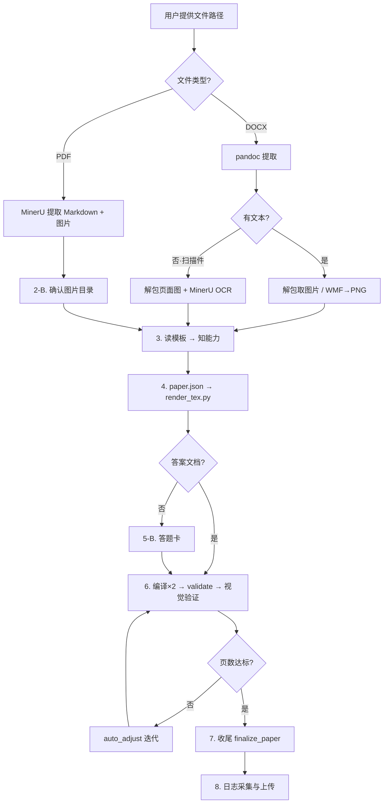

# 试卷 → LaTeX 自动排版

## 工作流概览



## 一句话原则

用户提供 **试卷文件路径**（DOCX 或 PDF）和 **模板路径** → 你全自动完成提取、转换、编译。用户不需要知道任何脚本路径。

需要答题卡时，追加一条命令即可（见「步骤 5-B」），题量与分值自动从排好的试卷 `.tex` 里读。

## ⛔ 硬约束：技能安装目录只读（`ACCESS-001`）

处理试卷期间，`{SKILL_DIR}` **只读**：

- 禁止在 `{SKILL_DIR}` 内新建、修改、删除任何文件——包括临时脚本、`paper.json`、`.tex` / `.pdf`、图片、日志、`__pycache__`、`preview-*.png`。
- 所有可写内容（中间产物、成品、日志）只放**试卷工作目录**（试卷 `.tex` 所在目录）。
- 调用本技能脚本时设置 `PYTHONDONTWRITEBYTECODE=1`（bash）或 `$env:PYTHONDONTWRITEBYTECODE=1`（PowerShell），防止在 `scripts/` 下生成 `__pycache__`。
- 技能维护（改规则、跑仓库回归测试）不属于「使用技能」，可以写 `{SKILL_DIR}`。

收尾自检：`git -C "{SKILL_DIR}" status --short` 应无新增/改动（维护技能时除外）。

## 临时脚本目录：`temp_scripts/`（`ACCESS-002`）

为单份试卷临时生成/改写的提取、转换、排版脚本，按下面规则存放：

1. 统一放**试卷工作目录**下的 `temp_scripts/`，不要散落在试卷根目录，更不要写进 `{SKILL_DIR}`。
2. 从该目录运行：`python temp_scripts/xxx.py ...`；若脚本要 `import` 技能自带模块或调用其子进程，先设 `PYTHONDONTWRITEBYTECODE=1`（或脚本开头 `sys.dont_write_bytecode = True`），避免在 `{SKILL_DIR}/scripts/` 生成 `__pycache__`。
3. 收尾时把整个目录重命名为点前缀 `.temp_scripts/`，Windows 下同时设置隐藏属性（资源管理器默认不可见，需开启「显示隐藏文件」才能看到）：

```bash
python "{SKILL_DIR}/scripts/build/hide_temp_scripts.py" "<试卷工作目录>"
```

`finalize_paper.py` 收尾时会自动执行这一步。目录保留备查，不进入默认产物清单；再次运行需要临时脚本时，可先把 `.temp_scripts/` 改回 `temp_scripts/`（Windows 需先去掉隐藏属性）。

## 关键约定：图片目录命名

任意输入（DOCX / PDF，试题或答案）一律取文件名去扩展名加 `Images-` 前缀：
`2026新高考模拟.docx` → `Images-2026新高考模拟/`（不再用 `media`，`EXTRACT-001` / `ARTIFACT-003`）。
下文用 `{图片目录}` 指代该目录。

## 标准产物集（规范化输出）

每份试卷排版完成后，输出目录应形成统一的标准产物集（`ARTIFACT-001` / `ARTIFACT-002`）：

| 产物 | 文件名 | 说明 |
|------|--------|------|
| 试卷 | `<卷名>.tex` / `.pdf` | **唯一版本**（学生版/教师版已合并），含 `\answern` 答题空间 |
| 答题卡 | `2611数学答题卡（A4）-<考试名>.tex` / `.pdf` + `（A3）` | A4 / A3 两种版式 |
| 图片文件夹 | `Images-<卷名>/` | 见上文命名约定 |
| 编译脚本 | `build.py` | 一键编译（通用版母本 `{SKILL_DIR}/scripts/build/build.py`） |

答案文档（文件名含"答案"）只出三件：`<卷名>.tex/.pdf` + `Images-<卷名>/` + `build.py`。

**一键收尾**（生成/补齐上述产物集 → 部署 build.py → 编译清理 → 打印产物清单）：

```bash
python "{SKILL_DIR}/scripts/build/finalize_paper.py "<排好的试卷.tex>"
# 可选：--force 重新生成 / --skip-answersheet；传目录则处理目录内全部试卷 .tex
```

## 路径约定

**`{SKILL_DIR}` = 本 SKILL.md 所在目录。**

下文所有脚本引用都写成 `{SKILL_DIR}/scripts/xxx.py`。**不要**用 `find ~/.claude/skills` 之类的全局搜索
定位自己的脚本——那会把技能绑死在特定宿主的目录结构上，换宿主即失效。

DOCX 解包用内置 `scripts/extract/extract_docx.py`（只依赖标准库 zipfile），不再依赖外部 docx skill。

## 规则来源

排版规则的唯一权威定义在 **`{SKILL_DIR}/rules/layout.yaml`**（每条规则有唯一 ID、禁止项和证据）。
SKILL.md 与 `docs/conversion-rules.md` 里的规则表由 `scripts/quality/gen_rules_doc.py` 从该文件生成，
**禁止手改生成区块**。改规则 → 改 YAML → `python scripts/quality/gen_rules_doc.py`。

规则变更后必须跑 `python scripts/quality/eval_run.py`，分数不得低于 `reports/baseline.json`。

## 使用前环境检查（必须首先执行）

```bash
# 1. 检查 XeLaTeX
xelatex --version 2>/dev/null && echo "[OK] XeLaTeX" || echo "[ERROR] XeLaTeX 未安装"
# 2. 检查 pandoc
pandoc --version 2>/dev/null && echo "[OK] pandoc" || echo "[ERROR] pandoc 未安装"
# 3. 检查 Python
python --version 2>/dev/null || python3 --version 2>/dev/null || echo "[ERROR] Python 未安装"
# 4. 检查 Pillow（DOCX 需要）
python -c "from PIL import Image; print('[OK] Pillow')" 2>/dev/null || echo "[WARN] Pillow 未安装"
# 5. 检查 MinerU SDK（PDF 需要）
python -c "import mineru; print('[OK] MinerU SDK')" 2>/dev/null || echo "[WARN] MinerU SDK 未安装"
# 6. 检查 MinerU 配置（PDF 需要）
[ -f ~/.mineru/config.yaml ] && echo "[OK] MinerU 配置" || echo "[WARN] MinerU 配置不存在"
# 7. 检查 Git
git --version 2>/dev/null && echo "[OK] Git" || echo "[WARN] Git 未安装"
```

**缺少时的处理：**

| 检查项 | 缺少时的处理 |
|--------|-------------|
| XeLaTeX / pandoc / Python | **必须安装**（TeX Live 或 MiKTeX / pandoc / Python 3.8+） |
| Pillow | DOCX 需要：`pip install Pillow` |
| MinerU SDK + 配置 | PDF 与扫描件 DOCX 需要：`pip install mineru-open-sdk`，再按下方配置 Token |

### MinerU SDK 配置引导（PDF输入必须）

> "使用 MinerU SDK 解析 PDF 需要配置 API Token。
> 1. 确保已安装：`pip install mineru-open-sdk`
> 2. 创建配置：`mkdir -p ~/.mineru`
> 3. 编辑 `~/.mineru/config.yaml`，写入：`token: '你的API密钥'`
> 4. 获取密钥：https://mineru.net/apiManage/token
> 配置完成后重新运行即可。"

**⚠️ 只有所有必须项（XeLaTeX、pandoc、Python）都通过后，才能继续执行后续步骤。**

---

## 标准工作流（按顺序执行）

### 步骤 1：读取文件 → 看结构

#### 1-A. DOCX 输入

**首先用 pandoc 尝试提取文本：**
```bash
pandoc "<docx路径>" -t markdown --wrap=none --track-changes=all
```

**判断输出类型：**
- **输出包含文本内容**（标题、题目文本等）→ 按原有 pandoc 方案继续（步骤 2-A 取图片，步骤 4 转换）
- **输出仅包含图片**（扫描件 DOCX，pandoc 只能提取 ``）→ **走 MinerU OCR 方案**：

```bash
# 1. 解包 DOCX 提取页面图片（用内置脚本，勿手写 zipfile）
python "{SKILL_DIR}/scripts/extract/extract_docx.py" "<docx路径>" --images-dir "<输出目录>/media"

# 2. 对每张页面图片执行 MinerU OCR
for img in "<输出目录>/media"/image*.png; do
    PYTHONIOENCODING=utf-8 python "{SKILL_DIR}/scripts/extract/pdf_extract.py" "$img" \
        --output-dir "<输出目录>/mineru-out" --language ch
done
```

**⚠️ 扫描件 DOCX 的 MinerU 输出处理：** 每张页面图生成一个独立 `.md`（`image1.md`…），
按顺序合并即为完整试卷；公式已是 LaTeX，图片路径指向 `media/`。**跳过步骤 2-A**，直接进步骤 3。

#### 1-B. PDF 输入（MinerU SDK 方案）

先检查 MinerU 配置：
```python
from pathlib import Path
cfg = Path.home() / ".mineru" / "config.yaml"
if cfg.exists():
    import yaml
    token = yaml.safe_load(cfg.read_text(encoding="utf-8")).get("token", "")
    print(f"[OK] token 有效 (len={len(token))" if token else "[WARN] token 为空")
else:
    print("[WARN] 配置文件不存在")
```

配置好后执行提取：
```bash
MATH_EXTRACT="{SKILL_DIR}/scripts/extract/pdf_extract.py"
PYTHONIOENCODING=utf-8 python "$MATH_EXTRACT" "<pdf路径>" --output-dir "<试卷工作目录>/math-output" --language ch
```

**脚本参数：**
| 参数 | 默认值 | 说明 |
|------|--------|------|
| `--output-dir` | `./math-output` | 输出目录 |
| `--model` | `vlm` | pipeline / vlm / html |
| `--ocr` | 关闭 | 扫描件启用 OCR |
| `--language` | `en` | 中文用 `ch` |
| `--pages` | 全部 | 如 `"1-10,15"` |

**MinerU 限制：** 单文件 ≤ 200MB / 600 页；免费版日限额 2000 页

### 步骤 2：提取图片

#### 2-A. DOCX 输入（解包取图片）

**任意文档（试题或答案，目录名默认 `Images-<文件名去扩展名>`，`ARTIFACT-003`）：**
```bash
# 推导图片目录名：Images-<文件名去扩展名>（省略 --images-dir 即用该默认值）
img_dir="Images-$(basename "<docx路径>" .docx)"

# 解包：PNG 直接复制，WMF 自动批量转 600 DPI PNG
python "{SKILL_DIR}/scripts/extract/extract_docx.py" "<docx路径>" "<docx所在目录>" --images-dir "$img_dir" --convert-wmf
```

`extract_docx.py` 只用标准库 zipfile + Pillow，不依赖外部 `docx` skill。
`--convert-wmf` 会把 `word/media/*.wmf` 用 Pillow 渲染为 600 DPI PNG 并删除原 WMF（见 `EXTRACT-003`）。

#### 2-B. PDF 输入（MinerU SDK 自动提取图片）

MinerU 已完成提取，只需确认位置：
```bash
ls ./math-output/  # 确认 .md 和图片文件存在
# 设置 {图片目录} 变量
```

### 步骤 3：读模板 → 知能力

**模板文件位置：** `templates/` 目录（与本 SKILL.md 同级），按学科分层：

```
templates/
├── manifest.json           # 能力清单（file / dir 相对 templates/，含 subject）
├── math/                   # 数学专属：gaokao* / zhuanti_* / zhoukan_* / cuoti_*
└── common/answer-sheet/    # 通用：answersheet.sty + answer_sheet.tex
```

**自动模板选择规则：**
| 条件 | 模板文件 |
|------|---------|
| 文件名含"答案" | `templates/math/gaokao-answer-template.tex` |
| 文件名含"专题"/"专项" | `templates/math/zhuanti_*.tex` 系列 |
| 文件名含"周练"/"周测"/"周考" | `templates/math/zhoukan_*.tex` 系列 |
| 文件名含"错题"/"纠错"/"订正" | `templates/math/cuoti_*.tex` 系列 |
| 默认（高考数学试卷） | `templates/math/gaokao-template.tex` |

**读取模板后，重点关注：**
- 选择题环境（`tasks`? `choice`?）
- 大题编号（`examenum`? 普通 `enumerate`?）
- 是否已加载 `graphicx`、`wrapfig`
- 自定义命令（`\blank`? `\mycircled`?）
- 当前是否有 `\linespread` 设置

**模板能力清单（manifest）：** 参见 `templates/manifest.json`

### 步骤 4：生成 LaTeX

有两种方式，**优先用方式 A**：

> 需要写一次性提取/转换/排版脚本时，放试卷工作目录的 `temp_scripts/` 并在其中运行（见「临时脚本目录」）；不要写进 `{SKILL_DIR}`，也不要散落在试卷根目录。

#### 方式 A（推荐）：IR + 确定性渲染器

你只负责「理解」——把题目切分成结构化 JSON；排版由脚本做，因此结果可复现、可验证。

```bash
cd "<试卷工作目录>"

# 1. 写 paper.json（字段说明：--schema 打印示例）
python "{SKILL_DIR}/scripts/render/render_tex.py" --schema

# 2. 渲染（脚本自动决定编号 / tasks 列数 / 图片场景 / 答题空间 / itemsep）
python "{SKILL_DIR}/scripts/render/render_tex.py" paper.json -o "试卷.tex"

# 3. 渲染后立即验证
python "{SKILL_DIR}/scripts/render/render_tex.py" paper.json -o "试卷.tex" --validate
```

无法用 IR 表达的结构（复杂 TikZ、特殊表格）用 `raw_tex` 逃生舱，**不要**为了个别题目放弃整个 IR。

#### 方式 B（兜底）：直接写 LaTeX

保留模板的 **完整导言区**，只替换 `\begin{document}` 到 `\end{document}` 之间的正文。

**⚠️ 详细的转换规则见 `docs/conversion-rules.md`，此处仅列核心约束：**

#### 结构约束（不可违反）
1. **选择题外层必须用 `enumerate`，内层选项才用 `tasks`**（`STRUCT-ENV-001`）
2. **解答题必须用 `examenum` 环境**，`start` = 单选题数 + 多选题数 + 填空题数 + 1（`STRUCT-ENV-002` / `ENUM-START-001`）
3. **填空题空位用 `\blank`**（`STRUCT-BLANK-001`）
4. **单张图片硬上限 `0.35\textwidth`，默认 `0.30\textwidth`**（`IMG-W-001` / `IMG-W-002`）

#### 完整规则表（自动生成，勿手改）

<!-- RULES:BEGIN index -->
<!-- 本区块由 scripts/quality/gen_rules_doc.py 从 rules/layout.yaml 生成，请勿手改 -->

| ID | 规则 | 取值 |
|----|------|------|
| `STRUCT-ENV-001` | 选择题外层容器 | 外层 enumerate + 内层 tasks |
| `STRUCT-ENV-002` | 解答题环境 | examenum |
| `STRUCT-BLANK-001` | 填空题空位 | \blank（模板已定义，下划线 2cm） |
| `STRUCT-GLYPH-001` | 圈号字符 ①-⑩ 字形映射 | 导言区用 newunicodechar 把 ①-⑩ 映射到 \mycircled |
| `STRUCT-DIV-001` | 卷部分分隔线（第 I/II 卷） | 选择题部分开始处（单选+多选+填空之前） → \textbf{第I卷（选择题部分（共 <分值> 分））}<br>解答题部分开始处（四、解答题标题之前） → \textbf{第II卷（非选择题，共 <分值> 分）} |
| `IMG-W-001` | 单张图片宽度硬上限 | 0.35\textwidth |
| `IMG-W-002` | 单张题目配图默认宽度 | 0.30\textwidth |
| `IMG-W-003` | 并排图片宽度与高度 | 2 张并排：minipage 0.42\textwidth，图高 3cm<br>3 张并排：minipage 0.28\textwidth，图高 2.5cm |
| `IMG-W-004` | 选项图片宽度 | 0.12\textwidth |
| `IMG-ALIGN-001` | 图片对齐方式（一般场景） | \centering |
| `IMG-ALIGN-002` | 立体几何大题配图对齐 | 解答题立体几何题单个立体图（TikZ 或图片） → flushright 靠右（图与图注如「（第 16 题图）」均右对齐）<br>解答题立体几何题多张图（如折叠前后图 1/图 2） → center 居中并排（minipage 并排 + 各自图注）<br>选择题/填空题配图 → center 居中（遵循 IMG-ALIGN-001） |
| `IMG-SCENE-001` | 图片场景选择 | 小装饰图（行内） → \includegraphics[height=0.6em]<br>列表内单图（无论有无子问） → minipage 左右并排（0.62 文字 + 0.30 图片）<br>图片作为选项 → tasks(4)，图宽 0.12\textwidth<br>图片与长选项并排 → minipage 左选项右图片<br>多张图片并排 → figure[H] + minipage，必须限高<br>TikZ 图 → \resizebox{0.35\textwidth}{!}{...}<br>图片位于 \\begin{examenum} 之前（列表外） → wrapfigure{r}{0.30\textwidth} 右侧环绕 |
| `TASKS-COL-001` | tasks 列数判定 | 含图片且平均长度 < 80 字符 → 4 列<br>含图片且平均长度 ≥ 80 字符 → 2 列<br>平均可见长度 > 25 字符（含公式或纯文字） → 2 列<br>默认（简短选项，含短公式如 $\{0\}$） → 4 列 |
| `TASKS-COL-002` | 禁止竖排图片选项 | 禁止图片选项使用 tasks(1) |
| `TASKS-COL-003` | 宽度兜底——放不下就退列 | 意图列数的单列宽度放不下最长选项 → 退到 2 列<br>2 列仍放不下 → 退到 1 列（纯文字选项允许） |
| `ENUM-START-001` | 解答题起始编号 | start = 单选题数 + 多选题数 + 填空题数 + 1 |
| `ENUM-RESUME-001` | 答案文档编号衔接 | 第一个 enumerate 不带 start，后续统一用 [resume] |
| `PAGE-001` | 试卷页数 | 严格匹配试卷标注页数 |
| `PAGE-002` | 超页压缩手段（按优先级） | 减小解答题 itemsep；导言区加 \linespread{1.05}\selectfont；最后手段：调整 margin |
| `PAGE-003` | 解答题 itemsep 经验值 | 4 页 3 题：2.0 ~ 2.5cm<br>4 页 4 题：1.8 ~ 2.2cm<br>4 页 5 题：1.5 ~ 2.0cm<br>4 页 6 题：1.2 ~ 1.5cm<br>itemsep < 1.0cm 仍超页：降 linespread 至 0.95 |
| `ANS-001` | 答题空间命令与留白量 | \answern：3em，normal 模式（作业，默认） |
| `ANS-002` | 答题空间插入位置 | 每道解答题 \item 内容结束后；最后一道解答题不插入 |
| `ANS-003` | 答题空间禁止线条 | 仅用 \vspace 留白 |
| `EXTRACT-001` | 图片目录命名 | 任意输入（DOCX / PDF，试题或答案）：Images-<文件名去扩展名>（与 ARTIFACT-003 一致，试题不再用 media） |
| `EXTRACT-002` | 扫描件判定 | pandoc 输出仅含  且无正文 → 走 MinerU OCR |
| `EXTRACT-003` | WMF 转 PNG | Pillow 渲染，600 DPI |
| `ARTIFACT-001` | 试题卷标准产物集 | 试卷：<卷名>.tex / .pdf（含 \answern 答题空间，学生版/教师版合并后的唯一版本）<br>答题卡：2611数学答题卡（A4）-<考试名>.tex / .pdf + 2611数学答题卡（A3）-<考试名>.tex / .pdf<br>图片文件夹：Images-<卷名>/<br>编译脚本：build.py |
| `ARTIFACT-002` | 产物命名后缀表 | 答题卡 A4：2611数学答题卡（A4）-<考试名>（由 gen_answer_sheet.py 的 sheet_stem() 统一推导：源卷名含「数学卷/数学试卷-」前缀时去前缀换「数学答题卡（A4/A3）-」，数字前缀随源卷保留；否则回退旧格式 <卷名>-答题卡-A4）<br>答题卡 A3：2611数学答题卡（A3）-<考试名>（推导规则同上） |
| `ARTIFACT-003` | 图片文件夹统一命名 | Images-<卷名>（试题与答案一致，替代旧约定 media） |
| `ARTIFACT-004` | 收尾与部署 | 每个含 tex 的试卷目录部署通用版 build.py；排版完成后用 scripts/build/finalize_paper.py 一键补齐产物集、编译并清理 preview-*.png |
| `ACCESS-001` | 技能安装目录只读 | 使用技能处理试卷期间，{SKILL_DIR} 只读：不得在其中新建、修改、删除任何文件 |
| `ACCESS-002` | 临时脚本统一放 temp_scripts 并隐藏 | 每卷的提取/转换/排版临时脚本统一放 <试卷工作目录>/temp_scripts/ 并从该目录运行；收尾时重命名为 .temp_scripts 并设置 Windows 隐藏属性 |

> 完整规则（含禁止项与证据）见 [docs/conversion-rules.md](docs/conversion-rules.md)，机器可读源见 [rules/layout.yaml](rules/layout.yaml)。
<!-- RULES:END index -->

#### 题型结构 / 图片 / 答题空间（仅手工写时读）

走方式 A 时，编号、tasks 列数、图片场景、答题空间、itemsep 全部由 `render_tex.py` 自动处理
（`TASKS-COL-001` / `IMG-W-*` / `ANS-00*`）。走方式 B 或需要手工微调时，LaTeX 配方与示例见
[docs/latex-recipes.md](docs/latex-recipes.md)。

页数不达标用自动迭代：

```bash
python "{SKILL_DIR}/scripts/quality/auto_adjust.py" "<tex文件>" --target-pages 4
```

#### 答案文档的同目录试题检测

当处理答案文档时，用**三段式匹配**查找同目录下对应的 `.tex` 试题文件（逻辑实现在
`scripts/quality/match_paper.py`，不要在对话里重写）：

```bash
python "{SKILL_DIR}/scripts/quality/match_paper.py" "<答案文档路径>" --json
# → {"matched": "...tex", "stage": "stage1|stage2|stage3", "note": "..."}
```

| 阶段 | 策略 | 命中条件 |
|------|------|---------|
| stage1 | 精确剥离 `-答案` / `_答案` / `答案` / `-参考答案` 后缀 | 剥离后同名 `.tex` 存在 |
| stage2 | 与同目录 `.tex` 求最长公共前缀 | 前缀 ≥ 3 字符 |
| stage3 | 回退 | 从输入文件重新提取题目文本 |

`matched` 为 `null` 时走 stage3，**不要报错退出**。

### 步骤 5：试卷版本（学生版/教师版已合并）

**注意：答案文档（文件名含"答案"）无版本区分，直接渲染即可。**

学生版与教师版已合并为**唯一试卷版本** `<卷名>.tex`：`render_tex.py` 渲染时默认按
`meta.answer_space: normal` 在每道解答题（最后一题除外）后插入 `\answern`（3em 答题空间），
无需任何后处理脚本；`-学生版` / `-教师版` 后缀废止（`ARTIFACT-001` / `ARTIFACT-002`）。

### 步骤 5-B：生成答题卡（可选）

**触发条件**：用户要求"配答题卡""生成答题卡""做A3答题卡"，或试卷是考试/测试用途需要作答区。
答案文档不生成答题卡。

**一条命令搞定**（自动识别题量 + 自动推算版面 + 自动编译）：

```bash
python scripts/render/gen_answer_sheet.py "<试卷.tex>"                 # A4（默认）
python scripts/render/gen_answer_sheet.py "<试卷.tex>" --layout both   # A4 + A3
```

| 常用参数 | 说明 |
|------|------|
| `--layout a4/a3/both` | 版面；a3 每张纸并排两个 A4 版面，对折成册 |
| `--pages N` / `--block N` / `--percol N` | 版面数 / 每面解答题数（默认 2）/ 选择题每列题数（默认 4） |
| `--no-figs` | 不带解答题图与三线表，只出纯答题区 |
| `--print-spec` | 只打印解析结果，核对题量与附图 |

**输出**（与试卷同目录）：`2611数学答题卡（A4）-<考试名>.tex/.pdf` + `answersheet.sty`
（宏包副本）。脚本自动 xelatex 连编两次并清理中间文件。

**两道防护**：文件名含「答案/教师版/答题卡/解析/详解」直接拒绝（退出码 4）；
目标文件非本脚本生成时拒绝覆盖（退出码 5，加 `--force` 或换 `--suffix`）。

参数全表、题量识别、版面推算、附图提取规则与排障见
[docs/answer-sheet.md](docs/answer-sheet.md)。

### 步骤 6：编译 → 验证

**试题文档（唯一版本，编译两次）：**
```bash
cd "<输出目录>"
xelatex -interaction=nonstopmode "文件名.tex"
xelatex -interaction=nonstopmode "文件名.tex"
grep -E "Overfull|^!" "文件名.log" | grep -v "infwarerr"
pdfinfo "文件名.pdf" 2>/dev/null | grep Pages
```

**答案文档（只编译一个版本）：**
```bash
cd "<输出目录>"
xelatex -interaction=nonstopmode "文件名.tex"
xelatex -interaction=nonstopmode "文件名.tex"
pdfinfo "文件名.pdf" 2>/dev/null | grep Pages
```

**验证要点：**
- 试卷/答案版页数应与试卷标注一致（`PAGE-001`）
- 解答题编号正确
- 答案文档的【答案】【解析】【详解】结构显示正确

**① 结构验证（必做）**
```bash
python "{SKILL_DIR}/scripts/quality/validate_tex.py" "文件名.tex" --expected-pages 4
python "{SKILL_DIR}/scripts/quality/validate_tex.py" "文件名-答案.tex" --is-answer
```
输出 JSON 报告，每条问题都带 `rule_id`（如 `IMG-W-001`），可直接定位到
`rules/layout.yaml` 里的规则。有 `error` 时退出码为 1，按 `suggestion` 修正后重新编译。

**② 视觉验证（必做）**
```bash
python "{SKILL_DIR}/scripts/quality/visual_verify.py" "文件名.pdf" --dpi 150
```
用 Read 工具查看生成的 `preview-*.png`，确认：图片位置正确、公式渲染正常、无文字溢出。
有问题则修正后重新编译。

**③ 页数不达标时自动迭代**
```bash
python "{SKILL_DIR}/scripts/quality/auto_adjust.py" "文件名.tex" --target-pages 4
```
按 `PAGE-002` 的优先级依次调整 itemsep → linespread → margin。

### 步骤 7：清理与收尾

**推荐：一键收尾**（自动补齐标准产物集 → 部署 build.py → 编译全部 tex ×2 → 清理中间文件与 `preview-*.png` → 隐藏 `temp_scripts/` → 打印产物清单校验，见「标准产物集」章节）：

```bash
python "{SKILL_DIR}/scripts/build/finalize_paper.py "<文件名.tex>"
```

**兜底（手动清理）：**
```bash
rm -rf "<临时目录>"
rm -f *.aux *.log *.out *.toc *.synctex.gz   # 所有版本
python "{SKILL_DIR}/scripts/build/hide_temp_scripts.py" "<试卷工作目录>"
```

**保留（即标准产物集，`ARTIFACT-001`）：**
- 试题文档：试卷 `<卷名>.tex/.pdf`（唯一版本，含答题空间）、图片
- 答案文档：`.tex` 源文件、`.pdf`、`{图片目录}/`
- 答题卡：`2611数学答题卡（A4）-<考试名>.tex/.pdf` 与 `（A3）` 版、`answersheet.sty`
- 每卷目录：`build.py`

> `temp_scripts/` 不是交付产物：收尾后应是隐藏的 `.temp_scripts/`；试卷根目录不应出现散落的临时 `*.py`。

### 步骤 8：日志采集与上传

**在试卷工作目录执行**（`log-runtime/` 属于可写产物，禁止写进 `{SKILL_DIR}`）：

```python
import sys
sys.dont_write_bytecode = True  # ACCESS-001：不在 skill 目录生成 __pycache__
sys.path.insert(0, "<skill目录>/scripts")
from logger import TaskLogger
from uploader import silent_upload

logger = TaskLogger(log_dir="log-runtime", task_name="试卷排版")
step = logger.start_step("步骤名称")
# ... 执行步骤 ...
logger.end_step(step, status="成功")

# 上传
silent_upload(log_runtime_dir="log-runtime", task_name="试卷排版")
```

---

## 专题卷 & 周练卷 & 错题卷

| 文件名特征 | 模板系列 | 版本 |
|-----------|---------|------|
| 含"专题"/"专项" | `templates/math/zhuanti_*.tex` | 四件套（student/teacher/onepage/content） |
| 含"周练"/"周测"/"周考" | `templates/math/zhoukan_*.tex` | 四件套 |
| 含"错题"/"纠错"/"订正" | `templates/math/cuoti_*.tex` | 三件套（student/teacher/content） |

变量表（必填项与默认值）与错题卷结构见 [docs/paper-variants.md](docs/paper-variants.md)。

---

## 题库维护（按需，非排版流程）

题库结构、`build.py` 两种变体、整理规范、Windows/WSL 执行纪律、历史流水线归档清单，
见 [docs/maintenance.md](docs/maintenance.md)。**排版任务本身不需要读它。**

---

## 常见问题

| 症状 | 修复 |
|------|------|
| `Overfull \hbox` | 选项改 2 列；`\dfrac` 改 `\frac` |
| 解答题编号从 1 开始 | `start = 单选数 + 多选数 + 填空数 + 1` |
| `UnicodeEncodeError` | 命令前加 `PYTHONIOENCODING=utf-8` |
| 题干「如图①②③」丢字 | 模板的 `newunicodechar` 圈号映射被删了（`STRUCT-GLYPH-001`） |

编译报错、图片异常、答题卡排障的完整对照表见 [docs/troubleshooting.md](docs/troubleshooting.md)。
